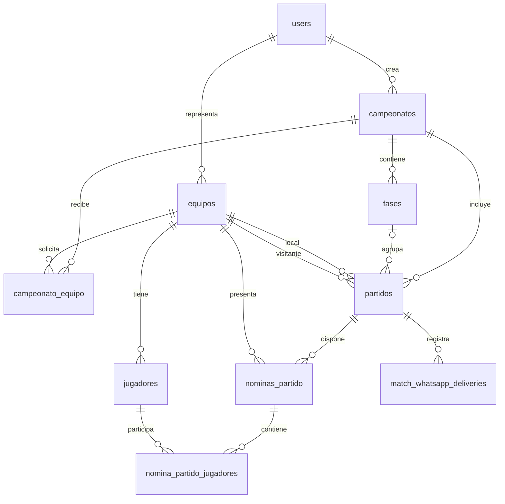

# Auditoría técnica para el Capítulo III

**Proyecto:** Plataforma Web para la Gestión de Campeonatos de Fútbol Amateur del Municipio de Sacaba.  
**Fecha de elaboración:** 23 de octubre de 2026.  
**Fuente:** código actual del directorio de trabajo, incluidos cambios locales todavía no confirmados en Git.

**Alcance y método.** Se inventariaron el código de aplicación, las rutas, las políticas, el middleware, los modelos, las 44 migraciones, las vistas, los servicios, JavaScript, la configuración, las dependencias y las pruebas existentes. El inventario contiene 56 archivos en `app/`, 41 vistas en `resources/views/`, 8 archivos en `resources/js/` y 15 archivos en `tests/`. Se revisaron las conexiones entre rutas, autorización, validación, persistencia y presentación. Las copias de `output/para-chatgpt-20261001-072639/`, el documento anterior `CAPITULO_III_ANALISIS_COMPLETO.md` y los materiales de `sub_programa/` no se utilizaron como prueba de funcionalidades actuales. Tampoco se considera que cada dependencia de `vendor/` o `node_modules/` sea un módulo desarrollado para el proyecto.

**Límites de comprobación.** Esta es una auditoría estática, no una certificación de funcionamiento. Se ejecutó únicamente una comprobación de sintaxis con `C:/xampp/php/php.exe -l` sobre 134 archivos PHP de aplicación, rutas, migraciones, configuración, bootstrap y pruebas, excluyendo la caché de bootstrap: **0 errores de sintaxis**. No se ejecutaron PHPUnit, migraciones, seeders, peticiones web, envío de mensajes ni consultas a la base de datos. La estructura descrita corresponde al resultado esperado de las migraciones, no a un inventario verificado de la base instalada. Los datos de conexión, contraseñas y tokens no se reproducen. El único archivo creado por esta auditoría es este informe.

En este documento, **IMPLEMENTADO** significa que existe un recorrido de código conectado para la función y su alcance indicado; **PARCIALMENTE IMPLEMENTADO** significa que existe código, pero falta una parte del flujo o hay una inconsistencia material; **NO IMPLEMENTADO** significa que no se encontró un recorrido funcional actual para esa capacidad. Ninguna de estas etiquetas implica una prueba de ejecución satisfactoria.

## 1. Actores y permisos reales

### 1.1 Identidad de los actores

| Actor para StarUML | Identificación real | Alcance y evidencia |
|---|---|---|
| Administrador general | `users.rol = desarrollador` | `app/Models/User.php`, constante `ROLE_DESARROLLADOR` y método `esDesarrollador()`. No usar `administrador` como valor técnico actual: la migración `2026_08_05_000000_change_rol_to_string_in_users_table.php` normaliza ese valor antiguo. |
| Organizador | `users.rol = organizador` | Gestiona sus campeonatos. Se comprueba `usuario_creador` en políticas y controladores; no basta con tener el rol. |
| Delegado | `users.rol = delegado` | Gestiona sus equipos y jugadores; se comprueba `equipos.delegado_id`. Puede tener varios equipos, con restricciones de inscripción por campeonato. |
| Público | Visitante sin sesión; además existe el valor histórico `publico` | El portal no exige cuenta. `RegisterController::validator()` solo acepta `delegado` y `organizador`, aunque `User::ROLE_PUBLICO` sigue existiendo. Una cuenta histórica `publico` tiene accesos autenticados adicionales que deben distinguirse del visitante. |

No existe actualmente un actor operativo Árbitro. `routes/web.php` no ofrece su módulo y `database/migrations/2026_09_27_010000_remove_retired_referee_schema.php` elimina su estructura. **Mesa de control es una función del Organizador propietario y del Administrador**, no un quinto rol: `NominaPartidoController::esMesa()`.

### 1.2 Cómo se aplican los permisos

1. `routes/web.php` exige `auth` para la zona de gestión y aplica `role:...` en determinadas rutas.
2. `app/Http/Middleware/CheckRole.php::handle()` compara el rol exactamente con la lista permitida. No concede una excepción automática al Administrador.
3. `app/Providers/AppServiceProvider.php::boot()` registra el alias `role`, las políticas y las directivas Blade. Que el alias no aparezca en `bootstrap/app.php` no constituye un error: está registrado en el proveedor.
4. `CampeonatoPolicy` y `EquipoPolicy` conceden acceso previo al Administrador mediante `before()`. Esto solo actúa cuando se consulta esa política; no anula un middleware restrictivo ni una comprobación explícita del controlador.
5. Los demás módulos emplean comprobaciones propias. Ejemplos: `PartidoController::autorizarCampeonato()`, `NominaPartidoController::autorizarEdicion()` y `JugadorController::organizadorPuedeVerJugador()`.

### 1.3 Matriz de funcionalidades por actor

**Convenciones:** “Propios” significa propiedad comprobada por el servidor; “todos” sigue sujeto a las validaciones del módulo. La columna Público corresponde al visitante sin sesión, salvo indicación expresa. “Endpoint” indica una operación autorizada en el servidor aunque la interfaz pueda no mostrar su botón.

| Funcionalidad | Administrador | Organizador | Delegado | Público | Evidencia principal |
|---|---|---|---|---|---|
| Consultar y buscar campeonatos publicados | Sí | Sí | Sí | Sí | `PortalPublicoController::index/show`, rutas `/` y `/torneos/{campeonato}` |
| Consultar calendario, resultados, posiciones, llaves, goleadores, tarjetas y plantillas públicas | Sí | Sí | Sí | Sí | `PortalPublicoController::show`, `resources/views/publico/show.blade.php` |
| Registrarse desde el formulario | Sin alta pública de administrador | Puede elegir organizador | Puede elegir delegado | Puede crear cuenta de uno de esos dos roles | `Auth/RegisterController::validator/create` |
| Ingresar, salir y administrar su perfil | Sí | Sí | Sí | Solo si ya tiene cuenta | `Auth/LoginController`, `PerfilController`, `Auth::routes()` |
| Consultar y marcar sus notificaciones | Sí | Sí | Sí | Solo cuenta autenticada | `NotificacionController` |
| Listar campeonatos internos | Todos | Solo creados por él | Publicados con inscripción propia pendiente/aprobada | No; cuenta `publico`: publicados | `CampeonatoController::index` |
| Abrir detalle interno de campeonato publicado | Sí | Sí, incluso de otro organizador, en consulta | Sí, aunque no esté inscrito | No; cuenta `publico`: sí | `CampeonatoPolicy::view` |
| Ver borradores o solicitudes de campeonato | Todos | Solo propios | No | No | `CampeonatoPolicy::view/before` |
| Crear campeonato | Sí | Sí | No | No | `CampeonatoPolicy::create/before`, `CampeonatoController::store` |
| Editar campeonato | Todos, salvo mientras está pendiente de revisión | Propios; tras aprobarse, solo datos permitidos en edición restringida | No | No | `CampeonatoController::edit/actualizarDatos/actualizarDatosInformativos` |
| Enviar campeonato a revisión | Sí, por política | Propios | No | No | `AprobacionCampeonatoController::enviar` |
| Aprobar o devolver campeonato | Sí | No | No | No | `AprobacionCampeonatoController::revisar` |
| Eliminar campeonato | Sí, incluso con participaciones y partidos | Propios sin equipos ni partidos | No | No | `CampeonatoController::destroy` |
| Generar fixture | Todos los aprobados con condiciones válidas | Propios aprobados con condiciones válidas | No | No | `CampeonatoController::generarFixture` |
| Cambiar clasificados por grupo, ida/vuelta y tercer lugar de Copa | Sí | Propios, antes del primer resultado de grupos y de crear eliminatorias | No | No | `CampeonatoController::actualizarClasificados` |
| Solicitar generación de eliminatoria de grupos | Sí | Propios | No | No | `CampeonatoEliminatoriaController::generar` |
| Crear equipo | Sí; queda asociado al administrador creador | No | Sí; queda asociado al delegado creador | No | `EquipoPolicy::create/before`, `EquipoController::store` |
| Listar panel de equipos | Todos, por URL autorizada | No | Propios | No | Middleware de `equipos.index`, `EquipoController::index` |
| Consultar ficha interna de cualquier equipo | Sí | Sí | Sí | No; cuenta `publico`: sí | `EquipoPolicy::view`, `EquipoController::show` |
| Editar equipo | Todos | Vinculados a sus campeonatos, incluso sin exigir inscripción aprobada | Propios | No | `EquipoPolicy::update`, `EquipoController::update` |
| Eliminar equipo | Solo sin dependencias | La política lo permite en equipos vinculados, pero la vinculación hace fallar el bloqueo de dependencias | Propios sin dependencias | No | `EquipoPolicy::delete`, `EquipoController::destroy` |
| Explorar campeonatos abiertos mediante pantalla de inscripción | No por esa ruta | No por esa ruta | Sí | No | Middleware `role:delegado` de `campeonatos.descubrir` |
| Solicitar inscripción de equipo existente | No por ese endpoint | No | Solo equipo propio y campeonato habilitado | No | Middleware de `equipos.solicitarInscripcion`, `EquipoController::solicitarInscripcion` |
| Crear equipo con solicitud inicial de inscripción | Sí | No | Sí | No | `EquipoController::store` permite `campeonato_id` opcional |
| Aprobar/rechazar inscripción de equipo | Todos | En campeonatos propios | No | No | `EquipoController::gestionarSolicitud`, middleware de ruta |
| Retirar equipo de campeonato | Sí por endpoint; botón no mostrado al administrador | En campeonatos propios | No | No | `EquipoController::retirarDelCampeonato`, `campeonatos/show.blade.php` |
| Crear/editar jugadores | Todos | No | En equipos propios; cambio de equipo solo entre propios | No | Middleware de jugadores y `JugadorController::store/update` |
| Eliminar jugador | Todos sin incidencias | No | Propios sin incidencias | No | `JugadorController::destroy`; véase pérdida de nóminas en sección 6 |
| Ver ficha individual privada de jugador | Todos | Equipos con inscripción aprobada en alguno de sus campeonatos | Solo propios | No, tampoco cuenta `publico` | Middleware y `JugadorController::show` |
| Aprobar/rechazar jugador | **No** | Si el equipo está aprobado en un campeonato propio | No | No | `role:organizador` y `JugadorController::aprobar/rechazar` |
| Crear, editar o borrar partido programado | En campeonatos aprobados | En campeonatos propios aprobados | No | No | `PartidoController::store/update/destroy` |
| Consultar nóminas/planilla web | Todas | Partidos de campeonatos propios | Partidos donde juega uno de sus equipos; ve las dos nóminas | No | `NominaPartidoController::autorizarConsulta` |
| Preparar nómina y asignar dorsales por partido | Cualquiera; se guarda aprobada | De ambos equipos de sus partidos; se guarda aprobada | Solo su equipo; se guarda pendiente | No | `NominaPartidoController::guardar` |
| Aprobar o devolver nómina | Sí | Partidos propios | No | No | `NominaPartidoController::gestionar` |
| Registrar/eliminar goles y tarjetas | Sí, mientras el partido siga programado | Partidos propios programados | No | No | `IncidenciaController::store/destroy` |
| Finalizar resultado y registrar tanda de penales | Sí | Partidos propios | No | No | `PartidoController::guardarResultado` |
| Declarar W.O. | Sí | Partidos propios | No | No | `PartidoWalkoverController::store` |
| Descargar reglamento PDF | Todos | Solo propios | No | No | `CampeonatoPolicy::downloadRules`, `ReglamentoPdfController` |
| Descargar jornada PDF | Todos | Solo propios | Cualquier campeonato aprobado, sin exigir inscripción | No | `CampeonatoPolicy::downloadFixture`, `FixturePdfController` |
| Descargar planilla PDF | Todas | Partidos propios | No | No | `NominaPartidoController::pdf/autorizarMesa` |
| Administrar cuentas o asignar roles desde panel web | No encontrado | No | No | No | No hay rutas/controladores de administración de usuarios en `routes/web.php` |

**Matiz sobre edición restringida:** un organizador puede cambiar nombre, descripción, reglamento interno, portada y `min_jugadores_partido` de su campeonato aprobado. No puede cambiar allí las fechas, el formato ni la apertura de inscripciones. El mínimo es una regla deportiva, aunque el método se denomine `actualizarDatosInformativos()`.

### 1.4 Indicaciones para el diagrama general de casos de uso

Conservar cuatro actores: **Administrador general, Organizador, Delegado y Público**. Asociar al Público los casos de consulta; a los demás también se les puede asociar esos casos. No representar al Administrador como una especialización que hereda incondicionalmente todos los casos del Organizador y del Delegado: la aprobación de jugadores y la solicitud de inscripción de un equipo existente son contraejemplos reales.

Casos de uso recomendados, respaldados por la matriz: gestionar campeonato; enviar campeonato a revisión; revisar campeonato; gestionar equipo; solicitar inscripción; resolver inscripción; retirar equipo; gestionar jugador; revisar jugador; generar fixture; configurar clasificación de Copa; programar partido; preparar nómina; revisar nómina; registrar incidencias; finalizar partido; declarar W.O.; consultar información deportiva; descargar documentos según permiso; administrar perfil; consultar notificaciones.

El cálculo de posiciones, la sincronización del marcador y el avance de llaves son comportamientos internos. No hace falta dibujarlos como acciones manuales independientes del Administrador. Si se descomponen los casos, finalizar un partido usa el marcador calculado; la tanda de penales y el avance solo se producen bajo sus condiciones. W.O. es un cierre alternativo que no requiere dos nóminas aprobadas. Evidencias: `PartidoController::guardarResultado`, `PartidoWalkoverController::store`, `TablaPosicionesService::calcular`.

La autenticación puede indicarse como precondición de los casos privados. No usar `«include»` para expresar simplemente que una acción ocurre después de otra; la secuencia creación → envío → revisión se explica mejor mediante actividad o estados.

## 2. Funcionalidades reales del sistema

| Módulo o capacidad | Clasificación | Qué está conectado y qué falta o limita su alcance | Evidencia |
|---|---|---|---|
| Inicio/cierre de sesión y registro | IMPLEMENTADO | Autenticación Laravel UI; registro de organizadores y delegados; contraseña confirmada de al menos 8 caracteres. No hay aprobación de la cuenta de organizador. | `routes/web.php`, `Auth/LoginController.php`, `Auth/RegisterController.php` |
| Perfil del usuario | IMPLEMENTADO | Nombre, correo, WhatsApp, consentimiento y cambio de contraseña con comprobación de contraseña actual. No cambia rol. | `PerfilController::update`, `perfil/edit.blade.php` |
| Recuperación de contraseña | PARCIALMENTE IMPLEMENTADO | Rutas, controladores y vistas presentes. El entorno leído usa `MAIL_MAILER=log`; no se acredita entrega de correo. | `Auth/ForgotPasswordController.php`, `Auth/ResetPasswordController.php`, `.env`, `config/mail.php` |
| Verificación de correo | NO IMPLEMENTADO como flujo habilitado | Existe scaffolding, pero `Auth::routes()` no activa `verify`, `User` no implementa `MustVerifyEmail` y las rutas privadas no exigen `verified`. | `routes/web.php`, `app/Models/User.php`, `Auth/VerificationController.php`; `vendor/laravel/ui/src/AuthRouteMethods.php` |
| CRUD y aprobación de campeonatos | IMPLEMENTADO | Borrador, envío, devolución motivada, corrección y aprobación/publicación; bloqueos y transacciones. Hay excepciones administrativas descritas en sección 6. | `CampeonatoController`, `AprobacionCampeonatoController`, `CampeonatoPolicy` |
| Reglamento y reglas deportivas | IMPLEMENTADO con alcance acotado | Texto de reglamento, modalidad, sexo, edades, tamaño de plantilla y mínimo para jugar. El texto libre no se convierte automáticamente en reglas ejecutables. | `CampeonatoController::validar`, `JugadorController::errorElegibilidadJugador`, `NominaPartidoController` |
| Equipos y escudos | IMPLEMENTADO | Alta, consulta, edición, eliminación condicionada e imagen local. No hay catálogo de ciudades ni reasignación de delegado desde este CRUD. | `EquipoController`, `EquipoPolicy`, `LocalImageService` |
| Inscripción y retiro de equipos | PARCIALMENTE IMPLEMENTADO | Solicitud, aprobación/rechazo, retiro con motivo y conservación de equipo. Falta validar integralmente plantillas preexistentes y proteger transiciones una vez generado el fixture. | `EquipoController::solicitarInscripcion/gestionarSolicitud/retirarDelCampeonato` |
| Registro y edición de jugadores | IMPLEMENTADO con limitaciones históricas | Datos personales, foto, validación de CI por campeonatos compartidos, sexo/edad y máximo de plantilla en altas. CI y fecha de nacimiento pueden ser opcionales según reglas. | `JugadorController::store/update` |
| Flujo obligatorio de aprobación de jugadores | PARCIALMENTE IMPLEMENTADO | Existen aprobar/rechazar y botones para pendientes; el alta omite estado y la migración lo deja aprobado. La aprobación es global al jugador y no por campeonato. | `JugadorController::store/aprobar/rechazar`, migración `2026_08_06_001200...`, `equipos/show.blade.php` |
| Selección de formatos nuevos | IMPLEMENTADO | Tres opciones: Liga, Copa de grupos y eliminación, y Relámpago de eliminación directa. | `Campeonato::$formatos`, `CampeonatoController::validar`, `campeonatos/create.blade.php` |
| Fixture de Liga | IMPLEMENTADO | Round-robin; descanso si cantidad impar. Hasta 10 equipos: dos vueltas; más de 10: una. No programa automáticamente fecha/hora/cancha. | `ConfiguracionFormatoService::calcular`, `LigaGenerator`, `LigaIdaVueltaGenerator` |
| Fixture de grupos | IMPLEMENTADO | Sorteo y reparto alternado en 2, 4 u 8 grupos según cantidad; partidos internos a una vuelta. Configuración de clasificación antes de comenzar. | `GruposEliminacionGenerator`, `ConfiguracionFormatoService`, `CampeonatoController::actualizarClasificados` |
| Clasificación de grupos a eliminatorias | IMPLEMENTADO con salvedad de retiros | Se dispara al cerrar el último partido de grupos o por endpoint; usa posiciones y cruces entre pares de grupos. No filtra equipos retirados al recuperar los IDs de metadata. | `ClasificacionGruposService::generar` |
| Eliminación directa con cualquier cantidad | PARCIALMENTE IMPLEMENTADO | Sortea y genera primera ronda; el avance existe para llaves completas. Los descansos de cantidades no potencia de dos carecen de avance persistido. | `EliminacionDirectaGenerator::generate`, `ResolucionEliminatoriaService::avanzarCruces` |
| Ida/vuelta, penales, final y tercer lugar | IMPLEMENTADO con alcance acotado | Servicios resuelven globales y penales; final única y tercer lugar opcional. La pantalla de configuración de ida/vuelta y tercer lugar está conectada a Copa, no a un nuevo Relámpago. | `ResolucionEliminatoriaService`, `LlavesCampeonatoService`, `CampeonatoController::actualizarClasificados` |
| Series/interseries | PARCIALMENTE IMPLEMENTADO como compatibilidad | Generador y parte de la consulta permanecen, pero no se acepta como formato de un nuevo campeonato. No presentarlo como cuarta opción vigente. | `SeriesInterseriesGenerator`, `CampeonatoController::generarFixture/validar`, `PortalPublicoController::show` |
| Liga con semifinales o cuadrangular como opciones independientes | NO IMPLEMENTADO en el alta actual | Quedan etiquetas históricas y conversión de datos; no son opciones admitidas ni generadores actuales independientes. | `Campeonato::$formatos`, migración `2026_08_20_000000_simplify_championship_formats.php` |
| Programación de partidos | PARCIALMENTE IMPLEMENTADO | Alta/edición de equipos, fecha, hora y cancha. Sin detección de solapamientos ni límites de fecha del torneo; edición puede desalinear fase y nóminas. | `PartidoController::validar/update`, `partidos/create.blade.php`, `partidos/edit.blade.php` |
| Nóminas y dorsales | PARCIALMENTE IMPLEMENTADO | Dorsales 1–99, sin repetición por nómina; jugadores aprobados, control de suspensión y mínimo al aprobar. Falta aplicar al PUT el bloqueo de nómina aprobada que sí existe al abrir el formulario. | `NominaPartidoController::editar/guardar/gestionar` |
| Resultados e incidencias | IMPLEMENTADO con inconsistencias de integridad | Marcador derivado de goles, tarjetas, doble amarilla automática, cierre y bloqueo posterior. No hay edición de resultado final ni registro de minuto en el endpoint actual. | `IncidenciaController`, `MarcadorPartidoService`, `PartidoController::guardarResultado` |
| W.O. | IMPLEMENTADO con excepción en ida/vuelta | Victoria 3–0 por inasistencia o jugadores insuficientes; sin crear goles individuales. Puede quedar sin resolución si provoca empate global en una vuelta. | `PartidoWalkoverController`, `ResolucionEliminatoriaService` |
| Sanciones | PARCIALMENTE IMPLEMENTADO | Roja o doble amarilla bloquea el siguiente partido según secuencia calculada. No hay tribunal, acumulación configurable de amarillas, sanción de varias fechas ni tabla de sanciones. | `SuspensionJugadorService` |
| Posiciones | IMPLEMENTADO | PJ, PG, PE, PP, GF, GC, diferencia y puntos; victoria 3, empate 1. Desempate por puntos, diferencia, goles a favor y nombre. Sin persistencia ni criterios configurables. | `TablaPosicionesService::calcular` |
| Estadísticas | IMPLEMENTADO con alcance básico | Top 10 de goleadores, tarjetas, historial por equipo y detalle de goles en portal. No se encontraron asistencias, posesión, tiros, mapas o estadísticas avanzadas. | `CampeonatoController::show`, `EquipoController::show`, `PortalPublicoController::show` |
| Portal público | IMPLEMENTADO | Búsqueda, paginación, reglamento, equipos aprobados, plantillas aprobadas, jornadas, resultados, clasificación y llaves. No permite administrar. | `PortalPublicoController`, `resources/views/publico/` |
| PDF | IMPLEMENTADO | Reglamento, jornada filtrada por fecha y planilla; permisos diferentes. Firmas como espacios para completar a mano. No firma digital. | `DocumentoPdfService`, controladores PDF, `resources/views/pdf/` |
| Notificaciones internas | IMPLEMENTADO | Persistencia en `notifications`, consulta individual y marcado de lectura. Hay avisos de inscripción, jugadores, nóminas y resultados. No todas las acciones generan aviso. | `NotificacionPlataforma`, `NotificacionController`, llamadas `notify()` |
| WhatsApp | IMPLEMENTADO en código; operación externa no verificada | Cliente Cloud API, consentimiento, plantillas, deduplicación y tarea periódica. Activado en `.env`, sin probar credenciales, plantillas ni entrega. No hay recepción de webhooks ni confirmación de lectura. | `WhatsAppService`, `WhatsAppChannel`, `NotificadorWhatsAppPartido`, `EnviarRecordatoriosPartidos`, `routes/console.php` |
| Gestión de usuarios, pagos, canchas como entidad, árbitros y reclamaciones | NO IMPLEMENTADO como módulos actuales | No hay CRUD/rutas/modelos actuales para esas capacidades. Cancha es texto del partido; reglamento libre no equivale a gestión de reclamaciones. | `routes/web.php`, `app/Models/`, migraciones actuales |
| Actualizaciones en tiempo real por WebSocket | NO IMPLEMENTADO | `fetch` actualiza partes de la interfaz; Echo/Pusher aparecen comentados. No equivale a difusión en tiempo real para todos los visitantes. | `resources/js/bootstrap.js`, `resources/js/match-sheet.js` |

## 3. Base de datos y modelos

### 3.1 Esquema esperado y convenciones

Las migraciones permiten reconstruir **19 tablas de aplicación e infraestructura**, más la tabla técnica `migrations` que Laravel utiliza para registrar la ejecución. No se verificó que todas existan físicamente en la base configurada. No se usó como inventario actual el archivo histórico `output/.../08_ESQUEMA_REAL_BASE_DATOS.json`.

`id()` define identificador entero grande autoincremental. Salvo que se indique otra cosa, las tablas de dominio incluyen `created_at` y `updated_at`. `?` indica un campo nullable. JSON significa almacenamiento estructurado en columna, no una tabla relacionada. Se separan las FK físicas de las referencias lógicas sin restricción.

### 3.2 Tablas de dominio y de soporte funcional

| Tabla / modelo | Campos principales resultantes | PK, FK y restricciones |
|---|---|---|
| `users` / `User` | `id`, `name`, `email`, `email_verified_at?`, `password`, `remember_token?`, `rol` string(20), `whatsapp?`, `whatsapp_opt_in_at?`, timestamps | PK `id`; `email` único. `rol` no referencia una tabla de roles. Valor por defecto final: `publico`. |
| `campeonatos` / `Campeonato` | `id`, `nombre`, `descripcion?`, `reglamento_interno?`, `portada?`, `fecha_inicio`, `fecha_fin?`, `fecha_limite_inscripcion?`, `inscripciones_abiertas`, `estado`, `usuario_creador`, `formato?`, `formato_config?` JSON, `modalidad`, `jugadores_cancha`, `min_jugadores_partido?`, `min_jugadores_equipo`, `max_jugadores_equipo`, `nivel`, `categoria_edad`, `edad_min?`, `edad_max?`, `sexo`, `aprobacion_estado`, `aprobacion_motivo?`, `solicitado_at?`, `revisado_at?`, `revisado_por?`, timestamps | PK `id`; FK `usuario_creador → users.id` con cascade; FK `revisado_por → users.id` con SET NULL; índice de `aprobacion_estado`. `nivel` existe en migración pero no se gestiona en el formulario actual. |
| `equipos` / `Equipo` | `id`, `nombre`, `ciudad?`, `color_camiseta?`, `escudo?`, `campeonato_id?`, `delegado_id`, timestamps | PK `id`; FK histórica `campeonato_id → campeonatos.id` con cascade; FK `delegado_id → users.id` con cascade. `color_camiseta` no está gestionado por el CRUD actual. |
| `campeonato_equipo` / pivote sin modelo propio | `id`, `campeonato_id`, `equipo_id`, `estado`, `motivo_retiro?`, `retirado_at?`, `retirado_por?`, timestamps | PK `id`; único compuesto `(campeonato_id, equipo_id)`; FK a campeonato y equipo con cascade; FK `retirado_por → users.id` con SET NULL. Estados usados: pendiente, aprobado, rechazado, retirado. |
| `jugadores` / `Jugador` | `id`, `nombre`, `apellido?`, `dni?`, `whatsapp?`, `whatsapp_opt_in_at?`, `fecha_nacimiento?`, `sexo?`, `numero?`, `foto?`, `equipo_id`, `estado`, timestamps | PK `id`; FK `equipo_id → equipos.id` con cascade; único `(equipo_id, numero)`. **No hay unicidad global final de `dni`**. Estado por defecto de migración: aprobado. `numero` permanece, pero los formularios actuales usan dorsales por partido. |
| `fases` / `Fase` | `id`, `campeonato_id`, `nombre?`, `tipo`, `orden`, `metadata?` JSON, `estado`, timestamps | PK `id`; FK campeonato con cascade. Estados: pendiente, en_curso, finalizada. Los IDs de integrantes de grupos en `metadata.teams` no tienen FK física. |
| `partidos` / `Partido` | `id`, `campeonato_id`, `fase_id?`, `ronda_number?`, `orden_en_ronda?`, `equipo_local_id`, `equipo_visita_id`, `fecha?`, `hora?`, `cancha?`, `goles_local?`, `goles_visita?`, `penales_local?`, `penales_visita?`, `estado`, `whatsapp_recordatorio_enviado_at?`, `wo_motivo?`, `wo_equipo_perdedor_id?`, `wo_registrado_por?`, `wo_registrado_at?`, timestamps | PK `id`; FK campeonato y ambos equipos con cascade; FK fase con SET NULL. Referencias W.O. son enteros **sin FK declarada**. Local y visita siguen siendo obligatorios. No hay único para cruce/ronda ni restricción física local ≠ visita. |
| `incidencias` / `Incidencia` | `id`, `partido_id?`, `jugador_id`, `dorsal?`, `tipo`, `minuto?`, `creado_por?`, timestamps | PK `id`; índices en partido, jugador y creador. **No se declaran FK físicas** en esos tres campos. Tipos usados: gol, amarilla, doble_amarilla, roja. `minuto` no se captura en `IncidenciaController::store()`. |
| `nominas_partido` / `NominaPartido` | `id`, `partido_id`, `equipo_id`, `estado`, `motivo_respuesta?`, `enviado_at?`, `aprobado_at?`, `aprobado_por?`, timestamps | PK `id`; único `(partido_id, equipo_id)`; FK partido/equipo con cascade; FK aprobador a users con SET NULL. Estados usados: pendiente, aprobada, rechazada. |
| `nomina_partido_jugadores` / `NominaPartidoJugador` | `id`, `nomina_partido_id`, `jugador_id`, `dorsal`, `titular` boolean por defecto false, timestamps | PK `id`; FK nómina y jugador con cascade; únicos `(nomina_partido_id, jugador_id)` y `(nomina_partido_id, dorsal)`. `titular` existe pero el flujo actual no permite seleccionarlo. |
| `notifications` / `Illuminate\Notifications\DatabaseNotification` | `id` UUID, `type`, `notifiable_type`, `notifiable_id`, `data` texto, `read_at?`, timestamps | PK UUID; índice polimórfico de destinatario; sin FK física a users. `User` incorpora la relación mediante `Notifiable`. |
| `match_whatsapp_deliveries` / sin modelo propio | `id`, `partido_id`, `fingerprint` string(64), `sent_at?`, timestamps | PK `id`; FK partido con cascade; `fingerprint` único. Se usa con Query Builder en `NotificadorWhatsAppPartido::enviarUnaVez()`. |

**Evidencias de creación y evolución:**

| Elementos | Migraciones de referencia en `database/migrations/` |
|---|---|
| Usuarios y autenticación | `0001_01_01_000000_create_users_table.php`, `2026_07_30_043102_add_rol_to_users_table.php`, `2026_08_05_000000_change_rol_to_string_in_users_table.php` |
| Campeonatos, equipos y partidos | `2026_07_30_050055_create_campeonatos_table.php`, `2026_07_30_051610_create_equipos_table.php`, `2026_07_30_055623_add_escudo_to_equipos_table.php`, `2026_07_30_060356_create_partidos_table.php` |
| Jugadores e incidencias | `2026_08_06_000000_create_jugadores_table.php`, `2026_08_06_001200_add_estado_to_jugadores_table.php`, `2026_08_06_002000_create_incidencias_table.php` |
| Unicidad del documento y dorsal histórico | `2026_08_06_002222_add_unique_constraints_to_jugadores_table.php`, `2026_08_06_003000_drop_unique_dni_from_jugadores.php`, `2026_08_13_010000_ensure_dni_is_not_globally_unique.php` |
| Fases, formato, inscripciones y nulabilidad de programación | `2026_08_09_010000_create_fases_table.php`, `2026_08_09_010100_add_format_and_phase_to_campeonatos_and_partidos.php`, `2026_08_13_000000_restore_enrollments_and_fixture_schema.php` |
| Reglas deportivas y retiro | `2026_08_13_020000_add_roster_rules_to_campeonatos.php`, `2026_08_13_030000_add_sports_profile_to_campeonatos_and_jugadores.php`, `2026_08_13_040000_add_withdrawal_details_to_campeonato_equipo.php` |
| Notificaciones y portada | `2026_08_13_050000_create_notifications_table.php`, `2026_08_15_010000_add_portada_to_campeonatos_table.php` |
| Normalización de formatos | `2026_08_20_000000_simplify_championship_formats.php` |
| Contactos y consentimiento | `2026_08_30_010000_add_whatsapp_to_users_and_jugadores.php`, `2026_09_08_000000_add_whatsapp_opt_in_to_users.php`, `2026_09_09_000000_add_whatsapp_opt_in_to_jugadores.php` |
| Nóminas y recordatorios | `2026_09_03_010000_create_nominas_partido_tables.php`, `2026_09_08_010000_add_whatsapp_reminder_to_partidos.php` |
| Aprobación y reglamento | `2026_09_24_010000_add_championship_approval.php`, `2026_09_28_000000_add_internal_rules_to_campeonatos.php` |
| Mínimo para jugar, W.O. y penales | `2026_09_30_000000_add_min_players_to_play_to_campeonatos.php`, `2026_09_30_030000_add_walkover_to_partidos.php`, `2026_10_01_000000_add_penales_to_partidos.php` |
| Deduplicación WhatsApp | `2026_10_01_010000_create_match_whatsapp_deliveries.php` |

### 3.3 Tablas de infraestructura restantes

| Tabla | Campos principales | Claves y observaciones |
|---|---|---|
| `password_reset_tokens` | `email`, `token`, `created_at?` | PK `email`; sin FK a users. |
| `sessions` | `id`, `user_id?`, `ip_address?`, `user_agent?`, `payload`, `last_activity` | PK string `id`; `user_id` indexado, **sin `constrained()`**. |
| `cache` | `key`, `value`, `expiration` | PK `key`; índice de expiración. |
| `cache_locks` | `key`, `owner`, `expiration` | PK `key`; índice de expiración. |
| `jobs` | `id`, `queue`, `payload`, `attempts`, `reserved_at?`, `available_at`, `created_at` | PK entero; índice de cola. |
| `job_batches` | `id`, `name`, `total_jobs`, `pending_jobs`, `failed_jobs`, `failed_job_ids`, `options?`, `cancelled_at?`, `created_at`, `finished_at?` | PK string. |
| `failed_jobs` | `id`, `uuid`, `connection`, `queue`, `payload`, `exception`, `failed_at` | PK entero; UUID único. |

Evidencias: las tres migraciones iniciales `0001_01_01_000000_create_users_table.php`, `0001_01_01_000001_create_cache_table.php` y `0001_01_01_000002_create_jobs_table.php`. La tabla `migrations` es infraestructura del framework y no tiene un modelo de dominio propio en `app/Models/`.

### 3.4 Relaciones y cardinalidades para StarUML

En `1:N`, un padre puede tener **cero o muchos** hijos. El lado hijo referencia exactamente un padre si el campo es obligatorio y `0..1` si admite null. Cuando no hay FK, la cardinalidad expresa la intención lógica y no una garantía del motor.

| Asociación | Cardinalidad | Métodos Eloquent y precisión |
|---|---|---|
| Usuario creador — Campeonato | 1:N | `Campeonato::organizador()` belongsTo por `usuario_creador`; `User` no declara la relación inversa. |
| Usuario revisor — Campeonato | 1:N; revisor opcional por campeonato | FK `revisado_por`; no existe método Eloquent específico para revisor. |
| Usuario delegado — Equipo | 1:N | `Equipo::delegado()` belongsTo; no hay `User::equipos()` declarado. El nombre del campo no obliga al usuario a tener rol delegado en la BD. |
| Campeonato — Equipo | N:M | `Campeonato::equipos()` y `Equipo::campeonatos()` belongsToMany mediante `campeonato_equipo`, con estado y retiro en pivote. |
| Campeonato — Equipo, referencia histórica | 1:N; campeonato opcional en equipo | `Equipo::campeonato()` belongsTo. Dibujar aparte y marcar como legado; no sustituye la N:M vigente. |
| Usuario que retira — Inscripción | 1:N; usuario opcional | FK `campeonato_equipo.retirado_por`; sin clase de inscripción ni relación personalizada. |
| Equipo — Jugador | 1:N | `Equipo::jugadores()` hasMany; `Jugador::equipo()` belongsTo. Cada fila jugador tiene un equipo actual. |
| Campeonato — Fase | 1:N | `Campeonato::fases()` / `Fase::campeonato()`. |
| Campeonato — Partido | 1:N | `Campeonato::partidos()` / `Partido::campeonato()`. |
| Fase — Partido | 1:N; fase opcional en partido | `Fase::partidos()` / `Partido::fase()`. |
| Equipo local — Partido | 1:N | `Equipo::partidosLocal()` / `Partido::equipoLocal()`. |
| Equipo visitante — Partido | 1:N | `Equipo::partidosVisita()` / `Partido::equipoVisita()`. Son dos asociaciones diferentes. |
| Partido — Incidencia | 1:N lógico; partido nullable en esquema | `Partido::incidencias()` / `Incidencia::partido()`; sin FK. La ruta actual exige partido existente. |
| Jugador — Incidencia | 1:N lógico | `Jugador::incidencias()` / `Incidencia::jugador()`; sin FK. |
| Usuario creador — Incidencia | 1:N lógico; creador opcional | `Incidencia::creador()`; sin FK. |
| Equipo — Incidencia | Relación derivada 1:N | `Equipo::incidencias()` es hasManyThrough por jugador; no hay `equipo_id` en incidencias. |
| Partido — Nómina | 1:N | `Partido::nominas()` / `NominaPartido::partido()`. El negocio espera dos, pero la BD no impone exactamente dos ni que sean los equipos del partido. |
| Equipo — Nómina | 1:N | `Equipo::nominasPartido()` / `NominaPartido::equipo()`. Para la pareja partido/equipo hay como máximo una nómina. |
| Usuario aprobador — Nómina | 1:N; aprobador opcional | `NominaPartido::aprobador()` por `aprobado_por`. |
| Nómina — Registro de jugador convocado | 1:N | `NominaPartido::jugadores()` devuelve registros `NominaPartidoJugador`, no objetos `Jugador` directamente; `NominaPartidoJugador::nomina()`. |
| Jugador — Registro de convocatoria | 1:N | `Jugador::participacionesPartido()` / `NominaPartidoJugador::jugador()`. Conceptualmente Nómina–Jugador es N:M mediante esta clase asociativa. |
| Usuario — Notificación | 1:N polimórfico | Relación incorporada por `Notifiable`; campos `notifiable_type/id`, sin FK física. |
| Partido — Registro de envío WhatsApp | 1:N | FK de `match_whatsapp_deliveries`; uso por Query Builder, sin modelo propio ni relación en `Partido`. |

**No se encontró una relación de dominio 1:1 explícita.** Un usuario no está limitado a un equipo. Un partido tampoco tiene una relación 1:1 con un modelo Resultado: el resultado está en sus propias columnas. No existen modelos `Inscripcion`, `Resultado`, `TablaPosiciones`, `Rol`, `Cancha` o `Estadistica` en `app/Models/`; algunos son conceptos del dominio, pero no clases persistentes implementadas.

Para un diagrama de clases de implementación, representar las nueve clases de `app/Models/`: `User`, `Campeonato`, `Equipo`, `Jugador`, `Fase`, `Partido`, `Incidencia`, `NominaPartido` y `NominaPartidoJugador`. Si se añade una clase conceptual Inscripción, rotular que representa `campeonato_equipo` y que no existe como clase Eloquent propia.

El esquema visual muestra las asociaciones principales con FK; completar en StarUML las asociaciones opcionales de revisión/aprobación y las referencias lógicas de incidencias según la tabla anterior. No interpretar una relación Eloquent como prueba de FK física.

### 3.5 Elementos retirados y atributos calculados

- `arbitro_campeonato`, `retired_referee_accounts` y `partidos.arbitro_id` se crean en migraciones antiguas y se eliminan en `2026_09_27_010000_remove_retired_referee_schema.php`. No deben figurar como estructura final esperada.
- `foto_cloudinary_id`, `escudo_cloudinary_id` y `portada_cloudinary_id` se agregan el 9 de septiembre y se eliminan en `2026_09_27_000000_remove_unused_cloudinary_columns.php`. El almacenamiento actual es local.
- `jugadores.posicion` se elimina si existe mediante `2026_09_30_020000_remove_position_from_jugadores.php`.
- `edad`, `estado_actual`, `minimo_para_jugar`, `foto_url`, `portada_url`, `escudo_url` y `numero_campeonato` son atributos calculados, no columnas. Evidencias: accessors de los respectivos modelos.
- No hay tabla de grupos separada: cada grupo es una `Fase` con tipo `grupo` e integrantes dentro de `metadata.teams`.
- No hay tabla de posiciones ni de sanciones: se calculan mediante `TablaPosicionesService` y `SuspensionJugadorService`.

## 4. Procesos principales del sistema

### 4.1 Creación y aprobación de campeonatos

1. **Organizador o Administrador:** abre el asistente `resources/views/campeonatos/create.blade.php`, de cuatro pasos. La política autoriza la creación.
2. `CampeonatoController::store()` valida nombre, fechas, formato, modalidad 5/6/7/8/9/11, plantilla, edad, sexo, reglamento e imagen. La fecha final, si existe, debe ser posterior al inicio; el límite de inscripción no puede ser posterior al inicio. El alta iguala `jugadores_cancha` a la modalidad.
3. Se guarda `usuario_creador = auth()->id()`, estado deportivo `pendiente`, configuración de formato vacía y estado de aprobación `borrador`. La portada se almacena localmente y se intenta limpiar si falla la persistencia.
4. **Creador autorizado:** envía a revisión mediante `AprobacionCampeonatoController::enviar()`. Dentro de una transacción bloquea la fila y solo admite `borrador` o `devuelto`; rechaza un campeonato ya finalizado por fechas/estado.
5. Pasa a `pendiente`, registra `solicitado_at` y limpia revisión anterior. Mientras espera revisión no puede editarse por el recorrido normal, tampoco por Administrador.
6. **Administrador:** `revisar()` acepta `aprobado` o `devuelto`. Para devolución exige motivo de 10 a 2000 caracteres. Solo procesa una solicitud pendiente y registra revisor y fecha.
7. La aprobación habilita la visibilidad del portal mediante `scopeAprobados()`. La devolución permite corregir y reenviar. No hay estado de aprobación llamado `rechazado`; el valor usado es `devuelto`.

No se encontró un `notify()` en este controlador de aprobación: no documentar un aviso automático por correo o WhatsApp en cada transición. El estado deportivo y el de aprobación son independientes; `Campeonato::getEstadoActualAttribute()` calcula próximo/en curso/finalizado por fechas, con prioridad del cierre almacenado.

### 4.2 Registro e inscripción de equipos

1. **Delegado:** crea equipo desde su panel o desde un campeonato. El Administrador también puede usar el alta por política. `EquipoController::store()` exige nombre, permite ciudad y escudo, y asigna `delegado_id` al usuario actual.
2. Puede crear el equipo sin campeonato. Si aporta campeonato, exige aprobación, inscripciones abiertas, no finalización y plazo vigente. Se verifica que ese usuario no participe ya con otro equipo pendiente, aprobado o retirado en el mismo campeonato.
3. El alta con campeonato crea equipo e inscripción `pendiente` en una transacción y conserva `campeonato_id` como referencia histórica. Se notifica al organizador.
4. Para inscribir un equipo existente, **solo el Delegado** usa `solicitarInscripcion()`. Se comprueba propiedad, condiciones de apertura, estado previo y CI repetida respecto de otros equipos del torneo. Una inscripción retirada no puede solicitarse otra vez por esta vía; una rechazada sí puede volver a pendiente si cumple condiciones.
5. **Organizador propietario o Administrador:** `gestionarSolicitud()` cambia el pivote a aprobado/rechazado y notifica al delegado. Comprueba que la relación exista, pero no exige que su estado anterior sea pendiente ni revalida plantilla completa, calendario o fixture.
6. **Organizador propietario o Administrador por endpoint:** `retirarDelCampeonato()` exige inscripción aprobada y motivo de 10 a 500 caracteres. Guarda motivo, usuario y fecha; no elimina equipo, jugadores ni partidos.

Las reglas de inscripción se implementan principalmente en `aceptaInscripciones()`, `delegadoYaParticipa()` y `ciDuplicadaAlInscribir()`. La restricción de un equipo por delegado y campeonato está en aplicación; el único de la BD solo cubre campeonato/equipo.

### 4.3 Registro y aprobación de jugadores

1. **Delegado propietario o Administrador:** abre el alta desde el equipo. `JugadorController::create/store()` verifica propiedad y valida nombre, documento opcional, nacimiento no futuro, sexo, foto y contacto opcional.
2. Obtiene campeonatos activos con inscripción pendiente/aprobada. Aplica el máximo de plantilla más restrictivo y comprueba elegibilidad en cada uno. La edad deportiva se calcula a la fecha de inicio del campeonato, no con la edad visible de hoy.
3. Si hay límites de edad, exige fecha de nacimiento. La CI, cuando se proporciona, se compara con el mismo equipo y equipos de campeonatos compartidos; no es única globalmente.
4. Guarda la foto en disco público y el contacto normalizado a `+591`. El consentimiento del jugador se registra cuando el usuario que llena la ficha lo confirma.
5. **Inconsistencia esencial:** `store()` no asigna `estado = pendiente`; la migración define `aprobado`. En una BD creada con estas migraciones, la fila se guardaría aprobada, aunque se envía el mensaje “Nuevo jugador pendiente”. No se comprobó si la BD instalada tiene un default diferente.
6. **Organizador:** los endpoints de aprobar/rechazar verifican que el equipo esté aprobado en al menos un campeonato suyo. Aprobar vuelve a comprobar sexo/edad; rechazar guarda `rechazado`. La vista del equipo solo ofrece esos botones cuando el jugador está pendiente.
7. La decisión modifica un único `jugadores.estado`, aplicable a todos los campeonatos del equipo. La edición de datos no devuelve el jugador a pendiente. Eliminar se bloquea por incidencias, pero no por convocatorias sin incidencias.

Evidencias: `JugadorController`, `app/Models/Jugador.php`, `resources/views/equipos/show.blade.php` y migración `2026_08_06_001200_add_estado_to_jugadores_table.php`.

### 4.4 Generación de fixture

1. **Organizador propietario o Administrador:** invoca `CampeonatoController::generarFixture()`.
2. Se exige campeonato aprobado, ausencia de fases y partidos previos y ausencia de solicitudes de equipos pendientes. No se exige que todos los jugadores estén revisados ni una plantilla mínima completa en cada equipo.
3. `ConfiguracionFormatoService::calcular()` cuenta equipos aprobados. Exige al menos 2; para Copa, al menos 4.
4. En Liga fija dos vueltas para 2–10 equipos y una vuelta para más de 10. `LigaGenerator::roundRobin()` rota participantes; añade un lugar vacío si el número es impar y omite los encuentros de descanso. `LigaIdaVueltaGenerator` invierte localías en la segunda vuelta.
5. En Copa elige 2 grupos hasta 10 equipos, 4 hasta 20 y 8 para más de 20. Clasifican inicialmente 2 por grupo si el grupo menor tiene al menos 3 equipos; en otro caso, 1. `GruposEliminacionGenerator` mezcla equipos y reparte alternadamente, guarda sus IDs en metadata y crea encuentros internos.
6. En eliminación directa se calcula la siguiente potencia de dos, se sortean equipos y se crean cruces de primera ronda. Los espacios vacíos se omiten; esta parte no completa correctamente el tratamiento de descansos, según sección 6.
7. Se guardan configuración, fases y partidos dentro de la transacción del controlador y se cierran inscripciones. Los partidos quedan con fecha, hora y cancha por definir.
8. En Copa pueden ajustarse clasificados, ida/vuelta y tercer lugar antes del primer partido de grupos jugado. Al finalizar todos los partidos de grupos, `ClasificacionGruposService` genera las eliminatorias automáticamente; también existe la ruta manual de `CampeonatoEliminatoriaController`.

Los espacios futuros dibujados por `LlavesCampeonatoService` son una proyección visual; no significan que todos los partidos de rondas futuras ya existan en la BD.

### 4.5 Programación de partidos

1. **Organizador propietario o Administrador:** abre crear/editar. El listado de elección filtra campeonatos aprobados y no finalizados.
2. `PartidoController::validar()` exige campeonato y equipos existentes, equipos distintos, fecha, hora y lugar. `equiposValidos()` exige que ambos estén aprobados en el campeonato.
3. Un partido de grupo solo permite equipos contenidos en `fase.metadata.teams`. La creación manual en una Copa que ya tiene grupos se rechaza.
4. Se guarda `lugar` del formulario en `partidos.cancha`. La creación manual no asigna fase, ronda ni orden; la edición conserva esos campos del registro previo.
5. Solo se editan/eliminan partidos con estado `programado`. El controlador de escritura no reproduce el filtro “no finalizado” del listado de campeonatos.
6. `NotificadorWhatsAppPartido::programacion()` intenta avisar si la integración está activa y hay fecha/hora. Al cambiar equipos, fecha, hora o cancha reinicia la marca de recordatorio e intenta notificar nuevamente.

No hay búsqueda de disponibilidad, reserva de cancha, duración de encuentro, validación de solapamiento o exigencia de fecha dentro del período del campeonato. Evidencias: `PartidoController::store/update/validar`, `resources/views/partidos/create.blade.php`, `edit.blade.php`.

### 4.6 Registro de resultados e incidencias

1. **Delegado participante:** prepara su nómina con dorsales únicos entre 1 y 99. `NominaPartidoController::guardar()` solo acepta jugadores aprobados de su equipo y consulta `SuspensionJugadorService`.
2. El delegado la envía pendiente. **Organizador propietario o Administrador**, como Mesa, puede llenar nóminas y guardarlas aprobadas o revisar las enviadas. Se exige el mínimo para jugar al aprobar; no se gestiona la condición de titular aunque exista la columna.
3. **Mesa:** registra `gol`, `amarilla` o `roja` en `IncidenciaController::store()`. El partido debe seguir programado y el jugador debe pertenecer a una nómina aprobada. El servidor no exige las dos nóminas aprobadas para cada incidencia, aunque la vista sí lo hace para mostrar los controles.
4. La segunda amarilla se convierte en `doble_amarilla`. Se bloquean nuevas tarjetas tras expulsión; no se bloquea un gol por ese motivo. Se guarda dorsal de convocatoria y usuario creador. No se captura minuto en el endpoint actual.
5. `MarcadorPartidoService::sincronizar()` cuenta incidencias de gol según el equipo actual de cada jugador y actualiza el marcador. La eliminación de una incidencia vuelve a sincronizar; si se borra la primera amarilla, una doble amarilla restante se normaliza a amarilla.
6. **Mesa:** finaliza con `PartidoController::guardarResultado()`. Exige exactamente dos nóminas aprobadas; bloquea campeonato y partido en transacción, revalida estado, sincroniza marcador y comprueba el desempate.
7. En eliminatorias empatadas se exige tanda con dos valores no negativos, distintos y hasta 999. En ida/vuelta se exige cerrar primero la ida y resolver el global al finalizar la vuelta. La final es a partido único. Los penales se guardan separados de los goles.
8. Cambia el partido a `jugado`, intenta generar clasificación de grupos y avanzar las llaves; notifica al organizador. Después, los endpoints normales impiden editar resultados/incidencias. No hay reapertura implementada.
9. **Alternativa W.O.:** `PartidoWalkoverController::store()` exige permiso, campeonato aprobado, partido programado, ambos equipos definidos, motivo permitido y ausencia de incidencias. Guarda 3–0 a favor del rival, metadatos W.O. y estado jugado, sin exigir nóminas ni crear goles de jugadores. Intenta clasificación/avance.

### 4.7 Actualización de tablas de posiciones

1. Al abrir el campeonato o el portal, el controlador obtiene equipos y partidos.
2. `TablaPosicionesService::calcular()` descarta partidos que no estén `jugado`.
3. Por cada equipo cuenta PJ, victorias, empates, derrotas y goles a favor/en contra.
4. Calcula diferencia `GF − GC` y puntos `3 × PG + PE`.
5. Ordena por puntos, diferencia y goles a favor descendentes; si persiste empate, por nombre ascendente. No usa enfrentamiento directo ni fair play.
6. En Copa cada tabla usa los partidos de su grupo. El servicio de clasificación usa estas tablas para elegir clasificados. W.O. participa con su marcador 3–0; los penales no afectan GF/GC.

No existe una acción manual “actualizar tabla” ni tabla persistida. Los resultados se reflejan en la siguiente consulta, sin demostrar actualización automática de una página ya abierta. Los controladores de consulta excluyen equipos no aprobados actualmente; esto puede ocultar estadísticas de retirados.

### 4.8 Consulta pública de campeonatos

1. **Visitante:** entra a `/`; `PortalPublicoController::index()` solo selecciona campeonatos aprobados.
2. Puede buscar por nombre con máximo 100 caracteres. El listado se ordena por estado deportivo calculado y fecha, con 8 campeonatos por página. `publico/index.blade.php` contiene carga adicional mediante `fetch`.
3. Al abrir `/torneos/{campeonato}`, `show()` responde 404 si no está aprobado.
4. Obtiene equipos con inscripción aprobada y jugadores globalmente aprobados; calcula posiciones, jornadas, goleadores, tarjetas y llaves.
5. La vista permite consultar reglamento, participantes, calendario/resultados, posiciones, llaves, goleadores y plantillas. Muestra nombres, fotos y edades; no imprime CI ni WhatsApp en esta vista pública.
6. Los PDF mantienen autorización propia. La ubicación pública de `/torneos/{campeonato}/reglamento.pdf` no concede su descarga al visitante: `Gate::authorize('downloadRules', ...)` la restringe.

**Límite de privacidad:** la ausencia de CI en el portal no garantiza reserva en toda la aplicación. `EquipoPolicy::view()` permite a cualquier usuario autenticado abrir fichas de equipos y la vista imprime CI. Véase sección 6.

## 5. Tecnologías utilizadas

### 5.1 Versiones observadas y uso real

| Tecnología | Versión/configuración observada | Instalación frente a uso | Evidencia |
|---|---|---|---|
| Laravel | `v12.64.0`; requisito `^12.0` | Bloqueado e instalado; framework de rutas, Eloquent, Blade, políticas y servicios. | `composer.json`, `composer.lock`, `vendor/composer/installed.json`, `bootstrap/app.php` |
| PHP | Requisito `^8.2`; CLI de XAMPP comprobado `8.2.12` | Ejecuta el código servidor. No se comprobó que Apache use exactamente ese mismo binario/configuración. | `composer.json`, salida de `C:/xampp/php/php.exe -v` |
| Base de datos | `.env`: `DB_CONNECTION=mysql` | Configuración de conexión tipo MySQL. **No se verificaron motor real, versión ni esquema aplicado**; no afirmar MySQL 8 o MariaDB por suponer XAMPP. | `.env`, `config/database.php` |
| SQLite | `:memory:` para pruebas | Configurado para PHPUnit; existencia de `database/database.sqlite` no prueba que sea la BD principal. | `phpunit.xml`, `database/` |
| Laravel UI | `v4.6.3` | Instalado y usado por autenticación tradicional. | Lock e inventario instalado; `Auth::routes()`, controladores Auth |
| Blade / Eloquent | Componentes de Laravel 12.64.0 | Vistas del servidor, modelos y Query Builder. No se encontró SPA independiente. | `resources/views/`, `app/Models/`, controladores |
| Bootstrap | `5.3.8`; requisito `^5.2.3` | Bloqueado e instalado; utilizado en Sass, JavaScript, formularios, modales, navegación y paginación. | `package-lock.json`, `node_modules/bootstrap/package.json`, `resources/sass/app.scss`, `resources/js/bootstrap.js`, `AppServiceProvider` |
| Bootstrap Icons | `1.11.3` por CDN | Se referencia desde el layout; carga efectiva depende de red/navegador, no comprobada. | `resources/views/layouts/app.blade.php` |
| JavaScript | Módulos ES y scripts de vistas | Uso real de `fetch`, DOM, eventos, validación, sessionStorage y SVG de llaves. No es una aplicación React/Vue. | Los 8 archivos de `resources/js/` y scripts Blade |
| Vite | `7.3.6` | Instalado y configurado; no se ejecutó build en esta auditoría. | Lock, paquete instalado, `vite.config.js`, `@vite` del layout |
| laravel-vite-plugin | `2.1.0` | Instalado y utilizado en configuración Vite. | `vite.config.js`, paquete instalado |
| Sass | `1.102.0` | Instalado; entrada Sass que importa Bootstrap. | `resources/sass/app.scss`, lock y paquete instalado |
| Popper | `2.11.8` | Instalado para componentes Bootstrap. | `package.json`, lock, paquete instalado |
| Axios | `1.19.0` | Instalado e importado a `window.axios`; no se identificaron llamadas de negocio con Axios. Las peticiones visibles usan `fetch`. | `resources/js/bootstrap.js`, búsqueda en código propio |
| Tailwind CSS | `4.3.3`; también se declara `@tailwindcss/vite` | Instalado, pero la hoja `resources/css/app.css` no está entre las entradas actuales de Vite y el plugin Tailwind no se activa en `vite.config.js`. No atribuirle el diseño activo sin evidencia adicional. | `package.json`, lock, `resources/css/app.css`, `vite.config.js` |
| Chart.js | Sin evidencia de instalación o uso actual | No encontrado en manifiestos/bloqueo ni invocaciones en el código propio revisado. Las estadísticas son tablas/listados. | `package.json`, `package-lock.json`, `resources/`, `app/` |
| DataTables / jQuery | Sin evidencia de instalación o uso actual | Las tablas HTML con clases Bootstrap no son DataTables. No se encontraron inicializadores ni dependencias correspondientes. | Mismas fuentes anteriores |
| Dompdf | `v3.1.6` | Instalado y utilizado directamente, sin wrapper `barryvdh/laravel-dompdf`. A4, imágenes locales y carga remota/PHP/JS desactivados. | `DocumentoPdfService`, `composer.lock`, inventario instalado |
| GD | Extensión exigida en Composer | Requisito declarado; no se realizó inventario completo de extensiones habilitadas. | `composer.json` |
| Almacenamiento de imágenes | Disco Laravel `public`, local | Usado para portada, escudos y fotos. La publicación de URL depende de configuración/enlace de almacenamiento, no verificados mediante HTTP. | `LocalImageService`, `config/filesystems.php`, accessors de modelos |
| WhatsApp Cloud API | Cliente HTTP; versión por configuración, fallback `v25.0` | Implementación presente y bandera activa en `.env`; no se comprobó el valor efectivo de versión en runtime ni la validez del servicio externo. | `WhatsAppService`, `config/services.php` |
| Sesión/caché/cola | `.env`: `database` para las tres | Configuradas; no demuestra que haya worker funcionando. Las notificaciones usan `Queueable` pero no implementan `ShouldQueue`, por lo que no debe afirmarse que se despachan en segundo plano. | `.env`, `config/`, `NotificacionPlataforma` |
| Scheduler | Comando cada 10 minutos | Declarado para recordatorios; no se verificó proceso scheduler/cron activo. | `routes/console.php`, `EnviarRecordatoriosPartidos`, script `composer dev` |
| PHPUnit | `11.5.56` | Instalado y pruebas escritas. No ejecutadas. | `composer.lock`, inventario instalado, `phpunit.xml`, `tests/` |
| Herramientas de desarrollo | Tinker `2.11.1`, Pint `1.30.0`, Pail `1.2.7`, Sail `1.64.0`; Node CLI observado `24.18.0` | Dependencias/herramientas presentes; Sail no prueba que el proyecto se ejecute en Docker. | `composer.lock`, scripts Composer, comando Node usado para inspeccionar JSON |

No se consultaron fuentes externas para atribuir funcionalidades o versiones: las cifras anteriores provienen del proyecto y del entorno local observado. Una versión exigida en un manifiesto, una versión bloqueada y una dependencia instalada son evidencias diferentes; en las dependencias principales se contrastaron bloqueo e inventario instalado.

### 5.2 Arquitectura que puede describirse en el Capítulo III

Aplicación web monolítica con Laravel: solicitudes HTTP → rutas y middleware → controladores → políticas y servicios de dominio → Eloquent/Query Builder → base de datos; respuesta mediante Blade, CSS y JavaScript. `DocumentoPdfService` agrega salida PDF y `WhatsAppService` una integración HTTP externa. No se encontraron microservicios, repositorios propios como capa obligatoria, frontend SPA ni una API REST completa para terceros.

La ruta `/api/equipos-campeonato/{campeonato}` está en `routes/web.php`, dentro del grupo autenticado, y sirve de apoyo a formularios. Su nombre `/api/` no prueba que exista autenticación por token o un módulo API independiente.

## 6. Errores, inconsistencias y límites relevantes para la defensa

Los siguientes hallazgos se deducen del código. No se ejecutaron escenarios de reproducción ni se afirma que ya hayan afectado datos reales. “Alta” indica impacto potencial en permisos, integridad deportiva o afirmaciones centrales del documento, no una puntuación formal de vulnerabilidad.

### 6.1 Hallazgos de prioridad alta

| ID | Hallazgo y consecuencia derivada | Evidencia concreta | Cómo documentarlo o qué corregir posteriormente |
|---|---|---|---|
| A01 | Alta de jugador no fuerza pendiente: la migración usa aprobado y el controlador avisa que espera revisión. La revisión previa no es obligatoria con ese esquema. | `JugadorController::store`, `Jugador` sin default alternativo, `2026_08_06_001200_add_estado_to_jugadores_table.php`, botones de `equipos/show.blade.php` | Calificar aprobación como parcial. Verificar default físico en una revisión posterior y, si se corrige, establecer pendiente explícitamente. |
| A02 | Aprobación de jugador global: un organizador puede cambiar el estado que afecta a otros campeonatos del mismo equipo. La edición mantiene aprobado aunque cambie identidad/equipo. | `JugadorController::aprobar/rechazar/update`, columna `jugadores.estado` | No dibujar una inscripción/aprobación Jugador–Campeonato inexistente. Si se requiere independencia, necesita un modelo de participación por torneo. |
| A03 | Eliminación directa incompleta para cantidades no potencia de dos. Con 3 equipos crea un partido, omite al tercero y el avance exige dos ganadores; con 6 genera tres cruces y falta una rama para completar 8 plazas. | `EliminacionDirectaGenerator::generate`, `ResolucionEliminatoriaService::avanzarCruces` | No afirmar soporte general de descansos automáticos. Registrar y propagar pases libres o limitar cantidades en una corrección posterior. |
| A04 | Bloqueo de nómina aprobada solo al abrir formulario: `editar()` lo aplica al delegado, pero `guardar()` no comprueba el estado previo y puede reemplazarla por pendiente mediante PUT. | `NominaPartidoController::editar/guardar`, ruta `partidos.nominas.guardar` | La restricción de interfaz no basta. Debe validarse la transición en escritura, con protección concurrente. |
| A05 | Consulta de equipos demasiado amplia para la reserva de CI: cualquier usuario autenticado pasa `EquipoPolicy::view()` y `equipos/show.blade.php` imprime el documento de todos sus jugadores. | `EquipoPolicy::view`, `EquipoController::show`, celda CI de la vista | No afirmar que solo propietario/organizador pueden ver documentos en toda la plataforma. La ficha individual sí restringe, pero el listado los expone. |
| A06 | Modificar partido permite cambiar campeonato/equipos conservando `fase_id`, ronda, nóminas e incidencias. No se comprueba que la fase pertenezca al nuevo campeonato. | `PartidoController::update/datosPartido/equiposPertenecenALaFase`, `partidos/edit.blade.php` | Los permisos sobre ambos campeonatos no garantizan coherencia. Bloquear cambio estructural cuando hay fase/historial o reconstruir relaciones de forma controlada. |
| A07 | Estadísticas y marcador vinculan goles al equipo actual del jugador. Cambiar `jugador.equipo_id` después de participar puede atribuir goles a otro equipo o excluirlos al resincronizar. | `JugadorController::update`, `MarcadorPartidoService::sincronizar`, `EquipoController::show`; incidencias sin equipo histórico | No presentar historial inmutable de transferencias. Se necesita conservar el equipo de participación histórica y restringir movimientos incompatibles. |
| A08 | Inscribir equipo existente no revalida máximos de plantilla, edades y sexo de todos sus jugadores; aprobar inscripción solo cambia estado. Un equipo preparado fuera del torneo puede saltar controles del alta individual. | `EquipoController::solicitarInscripcion/gestionarSolicitud`, contraste con `JugadorController::errorElegibilidadJugador/limitePlantillaParaEquipo` | La elegibilidad está parcialmente controlada. Incorporar validación de plantilla al inscribir/aprobar. |
| A09 | `gestionarSolicitud()` admite aprobar/rechazar cualquier relación existente, sin estado previo pendiente ni bloqueo por fixture. Puede reactivar retirados o alterar participantes tras generar partidos; tampoco limpia metadatos de retiro. | `EquipoController::gestionarSolicitud` frente a `retirarDelCampeonato` | No afirmar una máquina de estados cerrada para inscripciones. Definir transiciones válidas y efecto deportivo. |
| A10 | Retirar un equipo lo oculta de tablas públicas/internas, pero conserva sus partidos; `ClasificacionGruposService` recupera integrantes desde metadata sin exigir inscripción aprobada y puede clasificarlo. | `EquipoController::retirarDelCampeonato`, consultas de `CampeonatoController::show` y `PortalPublicoController::show`, `ClasificacionGruposService::generar` | Documentar conservación física y posible inconsistencia de presentación/clasificación; falta política uniforme de retiro deportivo. |
| A11 | El Administrador evita `changeFormat()` por el `before()` de la política y puede cambiar formato aunque haya partidos; estos no se reconstruyen. | `CampeonatoPolicy::before/changeFormat`, `CampeonatoController::actualizarDatos` | La frase “el formato nunca cambia después del fixture” es falsa para este actor. Restricción de integridad debe aplicarse también fuera de la autorización. |
| A12 | W.O. en vuelta puede empatar el global, pero no pasa por validación de penales. Queda jugado sin ganador y el cierre normal no permite completarlo. Ejemplo lógico: ida 3–0, vuelta 0–3 por W.O. | `PartidoWalkoverController::store`, `ResolucionEliminatoriaService::avanzarCruces`, bloqueo de `guardarResultado` | Distinguir W.O. de partido y resolución de serie. Definir y programar criterio para ese caso. |

### 6.2 Integridad, concurrencia y alcance de reglas

| ID | Hallazgo | Evidencia / efecto |
|---|---|---|
| B01 | Borrar partido programado no comprueba incidencias existentes. | `PartidoController::destroy`; `incidencias` no tiene FK, por lo que pueden quedar referencias huérfanas. `CampeonatoController::destroy` sí borra incidencias explícitamente. |
| B02 | Borrar jugador sin goles/tarjetas puede eliminar participaciones históricas. | `JugadorController::destroy` solo bloquea incidencias; FK `nomina_partido_jugadores.jugador_id` tiene cascade. Una nómina aprobada puede perder integrantes. |
| B03 | Aprobar una nómina vuelve a comprobar cantidad, pero no elegibilidad/suspensión/estado actual de cada jugador. | `NominaPartidoController::gestionar`; controles completos se hacen al guardar. Una expulsión registrada después de enviar nómina no se revalida al aprobarla. |
| B04 | Incidencias comprueban estado y tarjetas fuera de un bloqueo de fila. | `IncidenciaController::store/destroy`: la transacción no revalida un partido bloqueado como sí hace `guardarResultado`. Existe riesgo de carreras entre cierre y alta/eliminación de incidencias o doble tarjeta; no probado. |
| B05 | Generar fixture comprueba inexistencia antes de la transacción, sin lock ni índice único que impida una segunda generación simultánea. | `CampeonatoController::generarFixture`, migraciones de fases/partidos. Riesgo concurrente, no reproducción observada. |
| B06 | Unicidad de CI por torneo, máximo de plantilla y un equipo por delegado se comprueban en aplicación, sin bloqueo suficiente para solicitudes simultáneas. | `JugadorController::store`, `EquipoController::store/solicitarInscripcion`; únicos físicos distintos de esas reglas. No afirmar garantía transaccional absoluta. |
| B07 | No se valida solapamiento de equipos/cancha, formato estricto de hora ni fechas dentro del torneo. | `PartidoController::validar`: `fecha` es date y `hora` solamente required. La UI HTML aporta ayuda, pero no sustituye reglas servidor. |
| B08 | Mínimo de plantilla almacenado no se exige al aprobar equipo ni generar fixture. | `EquipoController::gestionarSolicitud`, `CampeonatoController::generarFixture`. No confundir `min_jugadores_equipo` con `min_jugadores_partido`, que sí se comprueba al aprobar nómina. |
| B09 | Partidos de campeonato finalizado pueden llegar a guardarse mediante petición directa. | El listado filtra `noFinalizadosActuales()`, pero `PartidoController::autorizarCampeonato()` comprueba aprobación y propietario, no `estado_actual`. |
| B10 | Finalizar la última ronda no cierra el campeonato ni actualiza necesariamente el estado de fase. | `ResolucionEliminatoriaService::avanzarCruces` retorna en ronda final; `ClasificacionGruposService` crea fase pendiente. `estado_actual` depende de fechas o estado almacenado, no de tener campeón. |
| B11 | Sanción de una fecha usa fecha e ID, no hora, y el equipo actual del jugador para verificar cumplimiento. | `SuspensionJugadorService::clave/estaSuspendidoPara`. Partidos el mismo día, reprogramaciones y transferencias pueden alterar el criterio. |
| B12 | Cambiar reglas “informativas” después de aprobar también permite bajar/cambiar el mínimo para jugar sin revalidar nóminas ya aprobadas. | `CampeonatoController::actualizarDatosInformativos`, `NominaPartidoController`, `PartidoController::guardarResultado`. |
| B13 | `GruposEliminacionGenerator::generate()` declara `$groupFases` dentro de la closure y retorna `$groupFases[0] ?? null` fuera. | La fase no se devuelve como sugiere el retorno; la generación por controlador persiste igualmente y no usa ese retorno. Además queda un bucle inactivo con `totalQualifiers = 0`. |
| B14 | El reglamento libre puede describir sanciones/desempates que el código no implementa. | `reglamento_interno` es texto; puntos y orden están fijos en `TablaPosicionesService`, suspensión fija en `SuspensionJugadorService`. No afirmar que el sistema ejecuta cualquier reglamento escrito. |
| B15 | Retiro y borrados no equivalen a una bitácora general de auditoría. | Hay fechas/autores para acciones concretas, pero no tabla de cambios completa ni histórico de versiones de jugadores/equipos. |

### 6.3 Diferencias entre interfaz y ejecución

| ID | Diferencia | Evidencia |
|---|---|---|
| C01 | El Administrador puede retirar equipo por endpoint, pero el botón/modal solo se dibuja para Organizador propietario. | `EquipoController::retirarDelCampeonato`, `resources/views/campeonatos/show.blade.php` |
| C02 | Un Organizador que consulta un campeonato aprobado ajeno puede ver botones de aprobación de solicitudes porque la vista comprueba rol, pero el controlador rechaza la operación por propiedad. | `campeonatos/show.blade.php` bloque de solicitudes, `EquipoController::gestionarSolicitud` |
| C03 | Se muestra eliminar equipo dentro de un campeonato, pero `destroy()` bloquea cualquier equipo con participaciones. | `campeonatos/show.blade.php`, `EquipoController::destroy` |
| C04 | Interfaz de incidencias exige dos nóminas aprobadas; el endpoint solo exige la nómina aprobada del jugador elegido. | `partidos/nominas.blade.php`, `IncidenciaController::store` |
| C05 | La planilla/PDF cuenta doble amarilla como expulsión en TR; el ranking de tarjetas cuenta como roja solo `tipo = roja`. | `partidos/nominas.blade.php`, `pdf/planilla.blade.php`, consultas de tarjetas en `PortalPublicoController`, `CampeonatoController`, `EquipoController` |
| C06 | “Goles registrados” del portal suma solo los 10 goleadores seleccionados, no necesariamente todos los goles del torneo. | `PortalPublicoController::show` usa `take(10)`; `publico/show.blade.php` usa `$goleadores->sum('goles_count')` |
| C07 | Goleadores y tarjetas incluyen incidencias de partidos aún programados; posiciones solo incluyen partidos jugados. | Consultas de incidencias sin filtro de estado del partido, frente a `TablaPosicionesService::calcular` |
| C08 | Mensaje público promete foto, nombre, dorsal y edad, pero la plantilla pública actual muestra foto, nombre y edad, sin dorsal. | `resources/views/publico/show.blade.php`, bloque plantillas |
| C09 | HTML del historial de goles abre `<header class="matchday-heading">` y cierra `
` dentro de `
`. | `resources/views/publico/show.blade.php`, bloque `goal-history`. Marcado inconsistente; efecto visual no comprobado en navegador. |
| C10 | Algunos resultados de penales usan `?` como separador y hay texto con codificación deteriorada. | `resources/views/publico/show.blade.php`, `campeonatos/show.blade.php`. Es un problema de presentación, no del almacenamiento numérico. |
| C11 | Ida/vuelta y tercer lugar existen en servicios para eliminación directa, pero el alta guarda configuración vacía y el endpoint de configuración solo acepta Copa. | `CampeonatoController::store/actualizarClasificados`, `ConfiguracionFormatoService`, `EliminacionDirectaGenerator` |
| C12 | La URL de reglamento parece pública, pero descarga es privada por política. | `routes/web.php`, `ReglamentoPdfController`, `CampeonatoPolicy::downloadRules`. No asociar esa descarga al Público en UML. |

### 6.4 Notificaciones, seguridad y operación no acreditada

| ID | Hallazgo | Evidencia y precisión |
|---|---|---|
| D01 | Recuperación de contraseña sin envío SMTP acreditado. | `.env` selecciona `MAIL_MAILER=log`; controladores existen, pero no se probó recuperación ni correo. |
| D02 | La respuesta de login distingue correo inexistente de contraseña incorrecta. | `Auth/LoginController::sendFailedLoginResponse()`. Permite inferir existencia de cuentas; es una decisión de UX con implicación de privacidad. No se realizó explotación. |
| D03 | Recordatorio y aviso inicial comparten la misma huella. | `NotificadorWhatsAppPartido::enviarUnaVez()` no incluye `esRecordatorio`; si ya se envió la programación idéntica, puede suprimirse el recordatorio de 24 horas. No documentar que ambos se envían siempre. |
| D04 | Un fallo de WhatsApp conserva la reserva y evita reintentos automáticos de esa huella. | `NotificadorWhatsAppPartido::enviarUnaVez()` deja fila con `sent_at = null`. Evita duplicados inciertos, pero no garantiza recuperación de entregas fallidas. |
| D05 | Con integración desactivada, tampoco se crean los avisos internos de programación en ese servicio. | Retorno temprano de `NotificadorWhatsAppPartido::programacion()` antes de `notify()`. Otros avisos internos sí se crean independientemente mediante `NotificacionPlataforma`. |
| D06 | `sent_at` refleja aceptación de la llamada, no confirmación de entrega/lectura por destinatario. | `WhatsAppService::comprobarRespuesta`, `NotificadorWhatsAppPartido`; no hay webhook de estados en `routes/web.php`. |
| D07 | Tablas de cola y trait `Queueable` no prueban procesamiento asíncrono de avisos. | `NotificacionPlataforma` no implementa `ShouldQueue`; llamadas HTTP de WhatsApp pueden ejecutarse durante la operación web. |
| D08 | Existen asignaciones HTML con nombres de equipo interpolados en JavaScript. | `resources/views/partidos/create.blade.php` y `edit.blade.php` construyen opciones con `innerHTML`; el nombre proviene de datos de usuarios y solo se valida como string. Requiere revisión de escape y uso de nodos/textContent; no se comprobó un exploit. |

### 6.5 Pruebas existentes y qué no puede afirmarse

Se encontraron 14 archivos de pruebas Feature más `tests/TestCase.php`: `ChampionshipApprovalTest`, `ChampionshipDeletionTest`, `ChampionshipRulesTest`, `ClasificacionGruposTest`, `DatabaseImageCleanupTest`, `DocumentoPdfTest`, `ExampleTest`, `LocalImageStorageTest`, `LoginVerificationTest`, `PartidoWalkoverTest`, `PenaltyShootoutTest`, `PublicMatchdayTest`, `RecoveredWorkflowTest` y `SharedBracketTest`. Sus nombres y código cubren distintos escenarios de autenticación, permisos, campeonatos, inscripciones, imágenes, resultados, clasificación y documentos. Su presencia no demuestra cobertura completa ni resultados satisfactorios.

`phpunit.xml` configura SQLite en memoria, caché/sesión de prueba, cola síncrona y WhatsApp desactivado forzosamente. Muchas pruebas usan `RefreshDatabase`. **No se ejecutaron** para respetar el encargo de solo análisis y evitar escrituras auxiliares. No hay evidencia generada en esta auditoría de pruebas de carga, navegadores, entrega WhatsApp, migración completa sobre MySQL o cobertura porcentual.

La comprobación de sintaxis sí realizada sobre 134 archivos no valida consultas SQL, permisos efectivos en runtime, renderizado Blade, integraciones ni corrección de reglas deportivas.

### 6.6 Redacción utilizable en la memoria de grado

> La plataforma implementa una aplicación web monolítica basada en Laravel 12, con vistas Blade y Bootstrap, para administrar campeonatos, equipos, jugadores, inscripciones y partidos. Incorpora revisión de campeonatos, generación de encuentros por formato, preparación y revisión de nóminas, registro de goles y tarjetas, resultados por W.O., resolución de eliminatorias y consulta pública de información deportiva. Las posiciones se calculan a partir de los resultados registrados. El alcance comprobado mediante análisis estático presenta limitaciones en la aprobación inicial de jugadores, la propagación de descansos en eliminación directa y la consistencia de algunas operaciones sobre datos históricos. La existencia del código y de pruebas automatizadas no se considera evidencia suficiente de funcionamiento integral sin su ejecución controlada.

Para la defensa, mantener separados el **diseño actual**, los **defectos identificados** y las **mejoras propuestas**. No presentar las mejoras sugeridas en esta sección como ya implementadas. Los diagramas deben reflejar el rol técnico `desarrollador`, la función de Mesa asumida por Organizador/Administrador, la relación N:M Campeonato–Equipo, la aprobación global actual de jugador y los distintos permisos de descarga.
