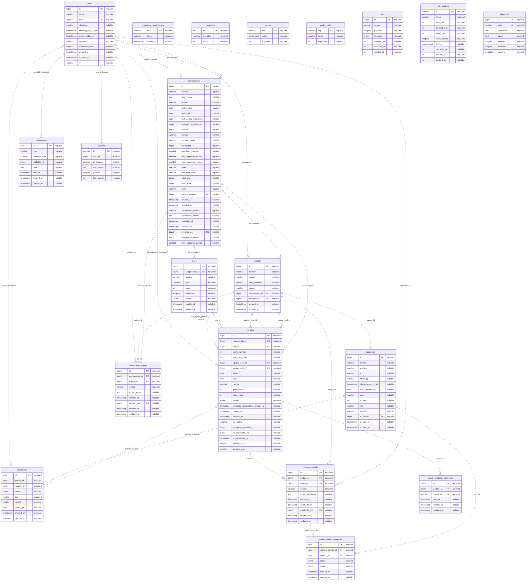

# Base de datos completa — Plataforma Fútbol Sacaba

Estructura consultada en la base de datos configurada el 2026-11-08. Todas las migraciones del proyecto figuran aplicadas. Incluye las 20 tablas de la aplicación y soporte de Laravel. No contiene datos personales ni credenciales.

PK: clave primaria. FK: clave foránea realmente declarada. UK: índice único de una sola columna. Los índices compuestos se detallan por tabla. Las relaciones lógicas se identifican expresamente y no implican una restricción en MySQL.

La tabla de posiciones se calcula en `app/Services/TablaPosicionesService.php`; no existe una tabla física `tablas_posiciones`. `equipos.campeonato_id` aún existe como vínculo heredado; la inscripción múltiple se representa mediante `campeonato_equipo`. Los grupos y la configuración de formatos se guardan en campos JSON, no en tablas de grupos independientes.

## users

| Campo | Tipo SQL | Clave | Permite NULL | Predeterminado |
|---|---|---|---|---|
| id | bigint(20) unsigned | PK | No | — |
| name | varchar(255) |  | No | — |
| email | varchar(255) | UK | No | — |
| whatsapp | varchar(16) |  | Sí | NULL |
| whatsapp_opt_in_at | timestamp |  | Sí | NULL |
| email_verified_at | timestamp |  | Sí | NULL |
| password | varchar(255) |  | No | — |
| remember_token | varchar(100) |  | Sí | NULL |
| created_at | timestamp |  | Sí | NULL |
| updated_at | timestamp |  | Sí | NULL |
| rol | varchar(20) |  | No | 'publico' |

Índices:

- `primary`: id (PK).
- `users_email_unique`: email (UNIQUE).

## campeonatos

| Campo | Tipo SQL | Clave | Permite NULL | Predeterminado |
|---|---|---|---|---|
| id | bigint(20) unsigned | PK | No | — |
| nombre | varchar(255) |  | No | — |
| descripcion | text |  | Sí | NULL |
| portada | varchar(255) |  | Sí | NULL |
| fecha_inicio | date |  | No | — |
| fecha_fin | date |  | Sí | NULL |
| fecha_limite_inscripcion | date |  | Sí | NULL |
| inscripciones_abiertas | tinyint(1) |  | No | 0 |
| estado | enum('pendiente','en_curso','finalizado') |  | No | 'pendiente' |
| formato | varchar(255) |  | Sí | NULL |
| formato_config | longtext |  | Sí | NULL |
| modalidad | tinyint(3) unsigned |  | No | 11 |
| jugadores_cancha | smallint(5) unsigned |  | No | 11 |
| min_jugadores_equipo | smallint(5) unsigned |  | No | 15 |
| max_jugadores_equipo | smallint(5) unsigned |  | No | 25 |
| nivel | varchar(80) |  | No | 'libre' |
| categoria_edad | varchar(80) |  | No | 'libre' |
| edad_min | tinyint(3) unsigned |  | Sí | NULL |
| edad_max | tinyint(3) unsigned |  | Sí | NULL |
| sexo | varchar(20) |  | No | 'mixto' |
| usuario_creador | bigint(20) unsigned | FK | No | — |
| created_at | timestamp |  | Sí | NULL |
| updated_at | timestamp |  | Sí | NULL |
| aprobacion_estado | varchar(255) |  | No | 'borrador' |
| aprobacion_motivo | text |  | Sí | NULL |
| solicitado_at | timestamp |  | Sí | NULL |
| revisado_at | timestamp |  | Sí | NULL |
| revisado_por | bigint(20) unsigned | FK | Sí | NULL |
| reglamento_interno | text |  | Sí | NULL |
| min_jugadores_partido | smallint(5) unsigned |  | Sí | NULL |

Índices:

- `campeonatos_aprobacion_estado_index`: aprobacion_estado.
- `campeonatos_revisado_por_foreign`: revisado_por.
- `campeonatos_usuario_creador_foreign`: usuario_creador.
- `primary`: id (PK).

## fases

| Campo | Tipo SQL | Clave | Permite NULL | Predeterminado |
|---|---|---|---|---|
| id | bigint(20) unsigned | PK | No | — |
| campeonato_id | bigint(20) unsigned | FK | No | — |
| nombre | varchar(255) |  | Sí | NULL |
| tipo | varchar(255) |  | No | — |
| orden | int(11) |  | No | 0 |
| metadata | longtext |  | Sí | NULL |
| estado | enum('pendiente','en_curso','finalizada') |  | No | 'pendiente' |
| created_at | timestamp |  | Sí | NULL |
| updated_at | timestamp |  | Sí | NULL |

Índices:

- `fases_campeonato_id_foreign`: campeonato_id.
- `primary`: id (PK).

## partidos

| Campo | Tipo SQL | Clave | Permite NULL | Predeterminado |
|---|---|---|---|---|
| id | bigint(20) unsigned | PK | No | — |
| campeonato_id | bigint(20) unsigned | FK | No | — |
| fase_id | bigint(20) unsigned | FK | Sí | NULL |
| ronda_number | int(11) |  | Sí | NULL |
| orden_en_ronda | int(11) |  | Sí | NULL |
| equipo_local_id | bigint(20) unsigned | FK | No | — |
| equipo_visita_id | bigint(20) unsigned | FK | No | — |
| fecha | date |  | Sí | NULL |
| hora | time |  | Sí | NULL |
| cancha | varchar(255) |  | Sí | NULL |
| goles_local | int(11) |  | Sí | NULL |
| goles_visita | int(11) |  | Sí | NULL |
| estado | enum('programado','jugado') |  | No | 'programado' |
| whatsapp_recordatorio_enviado_at | timestamp |  | Sí | NULL |
| created_at | timestamp |  | Sí | NULL |
| updated_at | timestamp |  | Sí | NULL |
| wo_motivo | varchar(40) |  | Sí | NULL |
| wo_equipo_perdedor_id | bigint(20) unsigned |  | Sí | NULL |
| wo_registrado_por | bigint(20) unsigned |  | Sí | NULL |
| wo_registrado_at | timestamp |  | Sí | NULL |
| penales_local | smallint(5) unsigned |  | Sí | NULL |
| penales_visita | smallint(5) unsigned |  | Sí | NULL |

Índices:

- `partidos_campeonato_id_foreign`: campeonato_id.
- `partidos_equipo_local_id_foreign`: equipo_local_id.
- `partidos_equipo_visita_id_foreign`: equipo_visita_id.
- `partidos_fase_id_foreign`: fase_id.
- `primary`: id (PK).

## equipos

| Campo | Tipo SQL | Clave | Permite NULL | Predeterminado |
|---|---|---|---|---|
| id | bigint(20) unsigned | PK | No | — |
| nombre | varchar(255) |  | No | — |
| ciudad | varchar(255) |  | Sí | NULL |
| color_camiseta | varchar(255) |  | Sí | NULL |
| escudo | varchar(255) |  | Sí | NULL |
| campeonato_id | bigint(20) unsigned | FK | Sí | NULL |
| delegado_id | bigint(20) unsigned | FK | No | — |
| created_at | timestamp |  | Sí | NULL |
| updated_at | timestamp |  | Sí | NULL |

Índices:

- `equipos_campeonato_id_foreign`: campeonato_id.
- `equipos_delegado_id_foreign`: delegado_id.
- `primary`: id (PK).

## campeonato_equipo

| Campo | Tipo SQL | Clave | Permite NULL | Predeterminado |
|---|---|---|---|---|
| id | bigint(20) unsigned | PK | No | — |
| campeonato_id | bigint(20) unsigned | FK | No | — |
| equipo_id | bigint(20) unsigned | FK | No | — |
| estado | varchar(20) |  | No | 'pendiente' |
| motivo_retiro | text |  | Sí | NULL |
| retirado_at | timestamp |  | Sí | NULL |
| retirado_por | bigint(20) unsigned | FK | Sí | NULL |
| created_at | timestamp |  | Sí | NULL |
| updated_at | timestamp |  | Sí | NULL |

Índices:

- `campeonato_equipo_campeonato_id_equipo_id_unique`: campeonato_id, equipo_id (UNIQUE).
- `campeonato_equipo_equipo_id_foreign`: equipo_id.
- `campeonato_equipo_retirado_por_foreign`: retirado_por.
- `primary`: id (PK).

## jugadores

| Campo | Tipo SQL | Clave | Permite NULL | Predeterminado |
|---|---|---|---|---|
| id | bigint(20) unsigned | PK | No | — |
| nombre | varchar(255) |  | No | — |
| apellido | varchar(255) |  | Sí | NULL |
| dni | varchar(255) |  | Sí | NULL |
| whatsapp | varchar(16) |  | Sí | NULL |
| whatsapp_opt_in_at | timestamp |  | Sí | NULL |
| fecha_nacimiento | date |  | Sí | NULL |
| sexo | varchar(20) |  | Sí | NULL |
| numero | int(10) unsigned |  | Sí | NULL |
| foto | varchar(255) |  | Sí | NULL |
| estado | varchar(20) |  | No | 'aprobado' |
| equipo_id | bigint(20) unsigned | FK | No | — |
| created_at | timestamp |  | Sí | NULL |
| updated_at | timestamp |  | Sí | NULL |

Índices:

- `jugadores_equipo_id_numero_unique`: equipo_id, numero (UNIQUE).
- `primary`: id (PK).

## incidencias

| Campo | Tipo SQL | Clave | Permite NULL | Predeterminado |
|---|---|---|---|---|
| id | bigint(20) unsigned | PK | No | — |
| partido_id | bigint(20) unsigned |  | Sí | NULL |
| jugador_id | bigint(20) unsigned |  | No | — |
| dorsal | tinyint(3) unsigned |  | Sí | NULL |
| tipo | varchar(255) |  | No | — |
| minuto | smallint(5) unsigned |  | Sí | NULL |
| creado_por | bigint(20) unsigned |  | Sí | NULL |
| created_at | timestamp |  | Sí | NULL |
| updated_at | timestamp |  | Sí | NULL |

Índices:

- `incidencias_creado_por_index`: creado_por.
- `incidencias_jugador_id_index`: jugador_id.
- `incidencias_partido_id_index`: partido_id.
- `primary`: id (PK).

## nominas_partido

| Campo | Tipo SQL | Clave | Permite NULL | Predeterminado |
|---|---|---|---|---|
| id | bigint(20) unsigned | PK | No | — |
| partido_id | bigint(20) unsigned | FK | No | — |
| equipo_id | bigint(20) unsigned | FK | No | — |
| estado | varchar(20) |  | No | 'pendiente' |
| motivo_respuesta | text |  | Sí | NULL |
| enviado_at | timestamp |  | Sí | NULL |
| aprobado_at | timestamp |  | Sí | NULL |
| aprobado_por | bigint(20) unsigned | FK | Sí | NULL |
| created_at | timestamp |  | Sí | NULL |
| updated_at | timestamp |  | Sí | NULL |

Índices:

- `nominas_partido_aprobado_por_foreign`: aprobado_por.
- `nominas_partido_equipo_id_foreign`: equipo_id.
- `nominas_partido_partido_id_equipo_id_unique`: partido_id, equipo_id (UNIQUE).
- `primary`: id (PK).

## nomina_partido_jugadores

| Campo | Tipo SQL | Clave | Permite NULL | Predeterminado |
|---|---|---|---|---|
| id | bigint(20) unsigned | PK | No | — |
| nomina_partido_id | bigint(20) unsigned | FK | No | — |
| jugador_id | bigint(20) unsigned | FK | No | — |
| dorsal | tinyint(3) unsigned |  | No | — |
| titular | tinyint(1) |  | No | 0 |
| created_at | timestamp |  | Sí | NULL |
| updated_at | timestamp |  | Sí | NULL |

Índices:

- `nomina_partido_jugadores_jugador_id_foreign`: jugador_id.
- `nomina_partido_jugadores_nomina_partido_id_dorsal_unique`: nomina_partido_id, dorsal (UNIQUE).
- `nomina_partido_jugadores_nomina_partido_id_jugador_id_unique`: nomina_partido_id, jugador_id (UNIQUE).
- `primary`: id (PK).

## match_whatsapp_deliveries

| Campo | Tipo SQL | Clave | Permite NULL | Predeterminado |
|---|---|---|---|---|
| id | bigint(20) unsigned | PK | No | — |
| partido_id | bigint(20) unsigned | FK | No | — |
| fingerprint | varchar(64) | UK | No | — |
| sent_at | timestamp |  | Sí | NULL |
| created_at | timestamp |  | Sí | NULL |
| updated_at | timestamp |  | Sí | NULL |

Índices:

- `match_whatsapp_deliveries_fingerprint_unique`: fingerprint (UNIQUE).
- `match_whatsapp_deliveries_partido_id_foreign`: partido_id.
- `primary`: id (PK).

## notifications

| Campo | Tipo SQL | Clave | Permite NULL | Predeterminado |
|---|---|---|---|---|
| id | char(36) | PK | No | — |
| type | varchar(255) |  | No | — |
| notifiable_type | varchar(255) |  | No | — |
| notifiable_id | bigint(20) unsigned |  | No | — |
| data | text |  | No | — |
| read_at | timestamp |  | Sí | NULL |
| created_at | timestamp |  | Sí | NULL |
| updated_at | timestamp |  | Sí | NULL |

Índices:

- `notifications_notifiable_type_notifiable_id_index`: notifiable_type, notifiable_id.
- `primary`: id (PK).

## sessions

| Campo | Tipo SQL | Clave | Permite NULL | Predeterminado |
|---|---|---|---|---|
| id | varchar(255) | PK | No | — |
| user_id | bigint(20) unsigned |  | Sí | NULL |
| ip_address | varchar(45) |  | Sí | NULL |
| user_agent | text |  | Sí | NULL |
| payload | longtext |  | No | — |
| last_activity | int(11) |  | No | — |

Índices:

- `primary`: id (PK).
- `sessions_last_activity_index`: last_activity.
- `sessions_user_id_index`: user_id.

## password_reset_tokens

| Campo | Tipo SQL | Clave | Permite NULL | Predeterminado |
|---|---|---|---|---|
| email | varchar(255) | PK | No | — |
| token | varchar(255) |  | No | — |
| created_at | timestamp |  | Sí | NULL |

Índices:

- `primary`: email (PK).

## migrations

| Campo | Tipo SQL | Clave | Permite NULL | Predeterminado |
|---|---|---|---|---|
| id | int(10) unsigned | PK | No | — |
| migration | varchar(255) |  | No | — |
| batch | int(11) |  | No | — |

Índices:

- `primary`: id (PK).

## cache

| Campo | Tipo SQL | Clave | Permite NULL | Predeterminado |
|---|---|---|---|---|
| key | varchar(255) | PK | No | — |
| value | mediumtext |  | No | — |
| expiration | int(11) |  | No | — |

Índices:

- `cache_expiration_index`: expiration.
- `primary`: key (PK).

## cache_locks

| Campo | Tipo SQL | Clave | Permite NULL | Predeterminado |
|---|---|---|---|---|
| key | varchar(255) | PK | No | — |
| owner | varchar(255) |  | No | — |
| expiration | int(11) |  | No | — |

Índices:

- `cache_locks_expiration_index`: expiration.
- `primary`: key (PK).

## jobs

| Campo | Tipo SQL | Clave | Permite NULL | Predeterminado |
|---|---|---|---|---|
| id | bigint(20) unsigned | PK | No | — |
| queue | varchar(255) |  | No | — |
| payload | longtext |  | No | — |
| attempts | tinyint(3) unsigned |  | No | — |
| reserved_at | int(10) unsigned |  | Sí | NULL |
| available_at | int(10) unsigned |  | No | — |
| created_at | int(10) unsigned |  | No | — |

Índices:

- `jobs_queue_index`: queue.
- `primary`: id (PK).

## job_batches

| Campo | Tipo SQL | Clave | Permite NULL | Predeterminado |
|---|---|---|---|---|
| id | varchar(255) | PK | No | — |
| name | varchar(255) |  | No | — |
| total_jobs | int(11) |  | No | — |
| pending_jobs | int(11) |  | No | — |
| failed_jobs | int(11) |  | No | — |
| failed_job_ids | longtext |  | No | — |
| options | mediumtext |  | Sí | NULL |
| cancelled_at | int(11) |  | Sí | NULL |
| created_at | int(11) |  | No | — |
| finished_at | int(11) |  | Sí | NULL |

Índices:

- `primary`: id (PK).

## failed_jobs

| Campo | Tipo SQL | Clave | Permite NULL | Predeterminado |
|---|---|---|---|---|
| id | bigint(20) unsigned | PK | No | — |
| uuid | varchar(255) | UK | No | — |
| connection | text |  | No | — |
| queue | text |  | No | — |
| payload | longtext |  | No | — |
| exception | longtext |  | No | — |
| failed_at | timestamp |  | No | current_timestamp() |

Índices:

- `failed_jobs_uuid_unique`: uuid (UNIQUE).
- `primary`: id (PK).

## Relaciones

| Tabla hija | Campo | Tabla referenciada | Tipo | Al eliminar padre |
|---|---|---|---|---|
| campeonatos | revisado_por | users | FK | set null |
| campeonatos | usuario_creador | users | FK | cascade |
| campeonato_equipo | campeonato_id | campeonatos | FK | cascade |
| campeonato_equipo | equipo_id | equipos | FK | cascade |
| campeonato_equipo | retirado_por | users | FK | set null |
| equipos | campeonato_id | campeonatos | FK | cascade |
| equipos | delegado_id | users | FK | cascade |
| fases | campeonato_id | campeonatos | FK | cascade |
| jugadores | equipo_id | equipos | FK | cascade |
| match_whatsapp_deliveries | partido_id | partidos | FK | cascade |
| nominas_partido | aprobado_por | users | FK | set null |
| nominas_partido | equipo_id | equipos | FK | cascade |
| nominas_partido | partido_id | partidos | FK | cascade |
| nomina_partido_jugadores | jugador_id | jugadores | FK | cascade |
| nomina_partido_jugadores | nomina_partido_id | nominas_partido | FK | cascade |
| partidos | campeonato_id | campeonatos | FK | cascade |
| partidos | equipo_local_id | equipos | FK | cascade |
| partidos | equipo_visita_id | equipos | FK | cascade |
| partidos | fase_id | fases | FK | set null |
| incidencias | partido_id | partidos | Lógica | Sin restricción FK; notifications es polimórfica |
| incidencias | jugador_id | jugadores | Lógica | Sin restricción FK; notifications es polimórfica |
| incidencias | creado_por | users | Lógica | Sin restricción FK; notifications es polimórfica |
| partidos | wo_equipo_perdedor_id | equipos | Lógica | Sin restricción FK; notifications es polimórfica |
| partidos | wo_registrado_por | users | Lógica | Sin restricción FK; notifications es polimórfica |
| sessions | user_id | users | Lógica | Sin restricción FK; notifications es polimórfica |
| notifications | notifiable_id | users | Lógica | Sin restricción FK; notifications es polimórfica |

## Diagrama Mermaid

