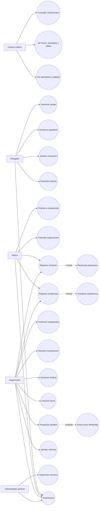
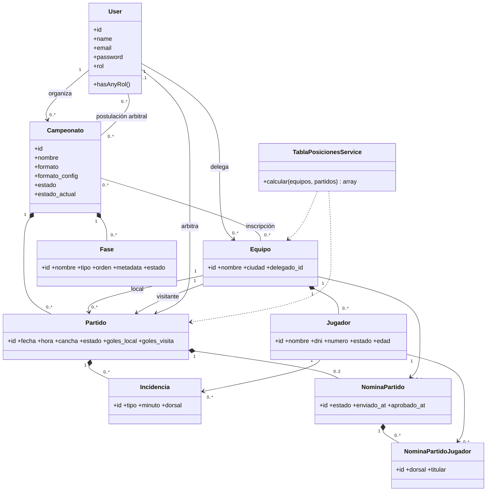
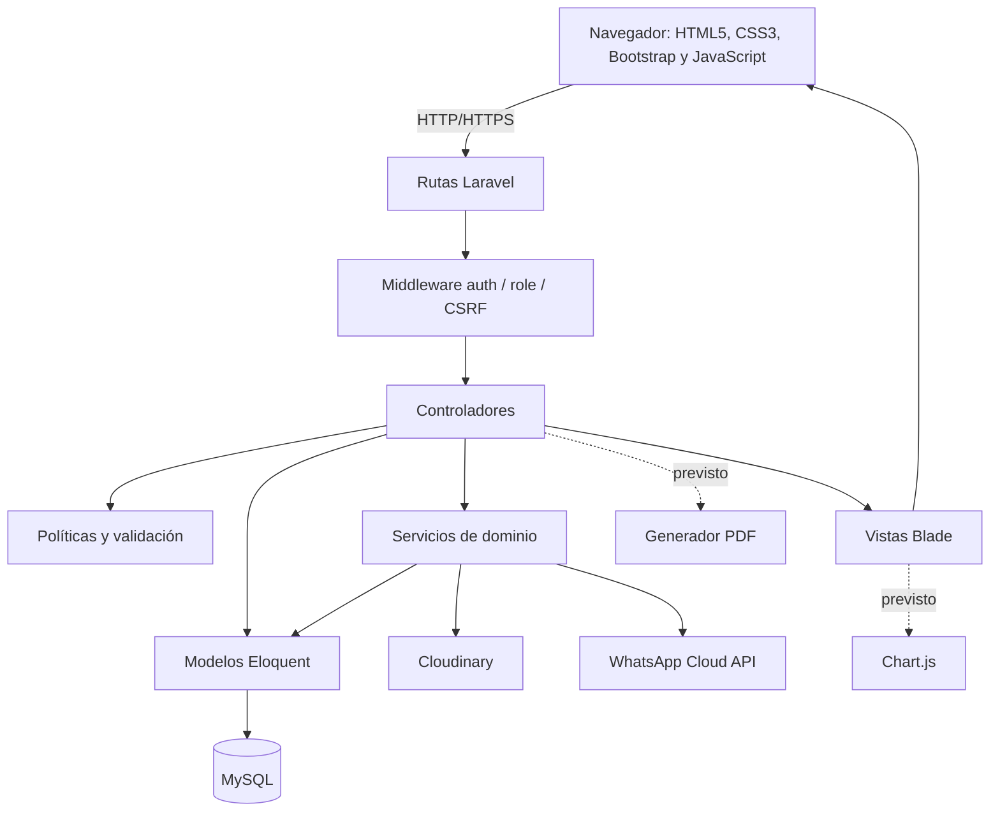
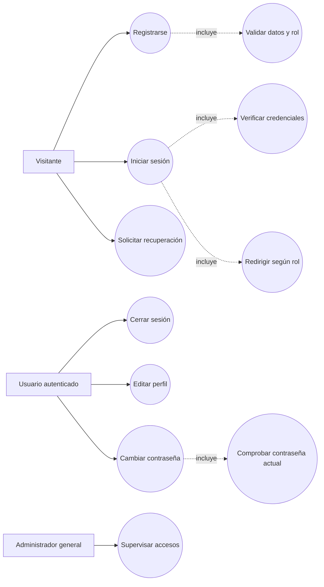
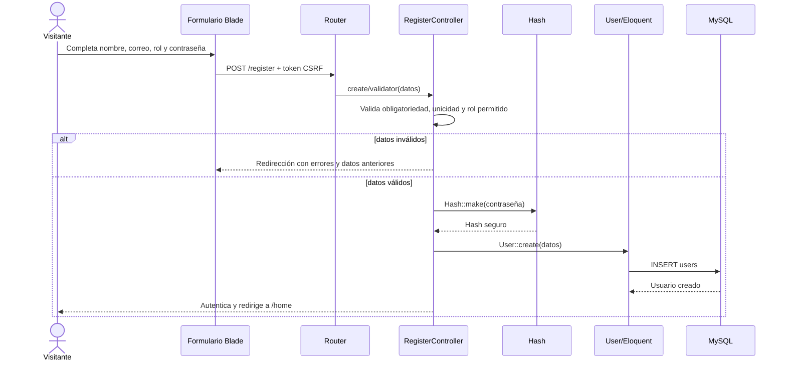
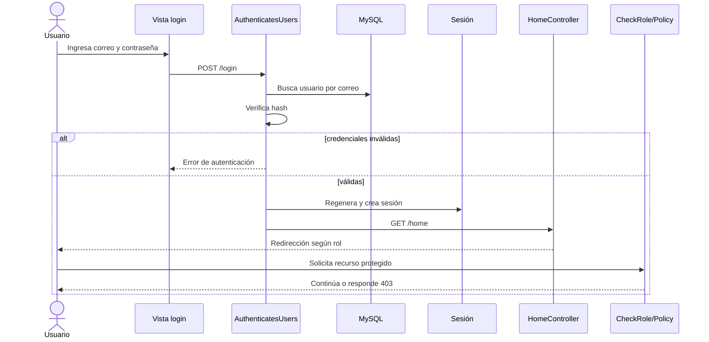
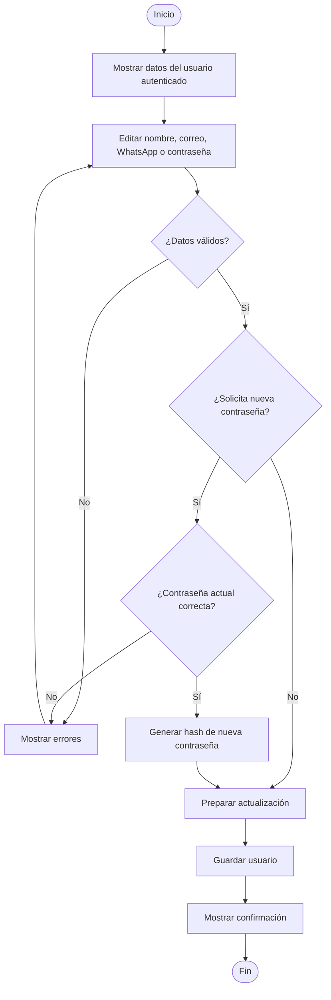

# CAPÍTULO III

# INGENIERÍA DEL PROYECTO

El presente capítulo describe el proceso de ingeniería empleado para el desarrollo de la plataforma web destinada a la gestión administrativa, el control estadístico y la difusión de información de los campeonatos de fútbol amateur del municipio de Sacaba. La solución fue concebida como una aplicación web centralizada, capaz de integrar en un mismo entorno la administración de campeonatos, equipos, jugadores, árbitros, partidos, nóminas, resultados, incidencias deportivas y consultas públicas.

La construcción del sistema se fundamentó en la metodología ágil Scrum y en una arquitectura Modelo–Vista–Controlador (MVC). En la implementación se empleó Laravel 12 sobre PHP 8.2 para la lógica del servidor; MySQL como sistema gestor de base de datos relacional; Blade, HTML5, CSS3, Bootstrap 5 y JavaScript para la capa de presentación; y Vite para la compilación de recursos. El diseño contempla Chart.js para la representación gráfica de indicadores y una biblioteca de generación PDF para reportes. Sin embargo, al momento del levantamiento técnico del repositorio, las estadísticas se presentan mediante tablas HTML y no se identificó todavía una dependencia instalada para Chart.js ni para exportación PDF. Por ello, ambas se documentan como componentes planificados del módulo de reportes y no como prestaciones ya concluidas. El sistema implementado también integra Cloudinary para imágenes y la API de WhatsApp para avisos autorizados por los usuarios.

## 3.1 REQUERIMIENTOS GENERALES DEL SISTEMA

Los requerimientos fueron determinados a partir de las actividades que intervienen en la organización de un campeonato: convocatoria, inscripción de equipos, habilitación de jugadores y árbitros, definición del formato de competencia, elaboración del fixture, programación de encuentros, presentación y aprobación de nóminas, registro de resultados e incidencias y publicación de información. Para favorecer su verificación, cada requerimiento posee un identificador único.

### 3.1.1 Requerimientos funcionales

| Código | Actor principal | Acción | Descripción del requerimiento |
|---|---|---|---|
| RF-01 | Visitante / usuario | Registrarse | El sistema permitirá crear una cuenta ingresando nombre, correo electrónico único, contraseña y rol operativo. Los roles disponibles en el registro público serán organizador, delegado y árbitro. El rol administrador general no podrá seleccionarse desde este formulario. |
| RF-02 | Usuario registrado | Autenticarse | El sistema permitirá iniciar y cerrar sesión mediante correo y contraseña. Tras autenticar al usuario, lo dirigirá al área correspondiente a su rol. |
| RF-03 | Usuario registrado | Recuperar credenciales | El sistema permitirá solicitar el restablecimiento de contraseña mediante el correo asociado a la cuenta. |
| RF-04 | Usuario registrado | Gestionar perfil | El usuario podrá actualizar su nombre, correo, número boliviano de WhatsApp, consentimiento de notificaciones y contraseña. El cambio de contraseña exigirá comprobar la contraseña vigente. |
| RF-05 | Administrador general | Supervisar el sistema | El administrador general tendrá acceso transversal a los recursos protegidos mediante las políticas de autorización. En el código este rol se almacena como `desarrollador`, aunque en la interfaz y en este documento se denomina administrador general. |
| RF-06 | Organizador | Gestionar campeonatos | El organizador podrá crear, consultar, modificar y eliminar campeonatos propios, registrando nombre, descripción, portada, fechas, estado, formato, modalidad, categoría, sexo y reglas de plantilla. |
| RF-07 | Organizador | Configurar competencia | El organizador podrá configurar campeonatos de liga, grupos con eliminación o eliminación directa, incluyendo vueltas, clasificados, tercer lugar y otros parámetros admitidos por cada formato. |
| RF-08 | Sistema / organizador | Generar fixture | A solicitud del organizador, el sistema generará automáticamente fases y partidos de acuerdo con el formato elegido y los equipos aprobados. |
| RF-09 | Delegado | Gestionar equipos | El delegado podrá registrar, consultar, actualizar y, cuando no exista historial incompatible, eliminar sus equipos, incluyendo nombre, ciudad y escudo. |
| RF-10 | Delegado | Solicitar inscripción | El delegado podrá postular uno de sus equipos a un campeonato que mantenga abiertas sus inscripciones. La solicitud quedará pendiente hasta la decisión del organizador. |
| RF-11 | Organizador | Resolver inscripción | El organizador podrá aprobar o rechazar solicitudes de equipos de sus campeonatos y retirar equipos, conservando el motivo, la fecha y el responsable de la decisión. |
| RF-12 | Delegado | Gestionar jugadores | El delegado podrá registrar, consultar, modificar y eliminar jugadores pertenecientes a sus equipos. Se almacenarán datos personales y deportivos, fotografía, dorsal y contacto opcional. |
| RF-13 | Sistema / organizador | Validar habilitación | El sistema comprobará las reglas del campeonato —límite de plantilla, edad, sexo y duplicidad de dorsal— y el organizador podrá aprobar o rechazar jugadores presentados. |
| RF-14 | Árbitro | Postular a campeonato | El árbitro podrá explorar campeonatos vigentes y solicitar formar parte del cuerpo arbitral, adjuntando un mensaje opcional. |
| RF-15 | Organizador | Gestionar árbitros | El organizador podrá aprobar o rechazar postulaciones arbitrales de sus campeonatos y asignar únicamente árbitros habilitados a los partidos. |
| RF-16 | Organizador | Programar partidos | El organizador podrá crear y modificar encuentros, indicando campeonato, fase, equipos local y visitante, fecha, hora, cancha y árbitro. |
| RF-17 | Delegado / organizador | Gestionar nóminas | El delegado podrá seleccionar los jugadores y dorsales de su equipo para un partido; el organizador podrá aprobar o rechazar la nómina, dejando constancia de la respuesta. |
| RF-18 | Árbitro / organizador autorizado | Registrar resultado | El actor autorizado podrá registrar goles local y visitante de un partido y cambiar su estado de programado a jugado. |
| RF-19 | Árbitro / organizador autorizado | Registrar incidencias | El actor autorizado podrá registrar y eliminar goles, tarjetas amarillas, dobles amarillas y tarjetas rojas, asociando partido, jugador, dorsal y minuto. |
| RF-20 | Sistema | Calcular posiciones | El sistema calculará automáticamente partidos jugados, ganados, empatados y perdidos, goles a favor, goles en contra, diferencia de goles y puntos, ordenando la tabla por criterios deportivos. |
| RF-21 | Sistema | Generar estadísticas | El sistema consolidará el ranking de goleadores y el resumen disciplinario de tarjetas a partir de las incidencias registradas. |
| RF-22 | Usuario público | Consultar información | Sin iniciar sesión, cualquier persona podrá buscar campeonatos y consultar datos generales, equipos aprobados, fixture, resultados, tablas de posiciones, goleadores, tarjetas y llaves eliminatorias. |
| RF-23 | Sistema | Emitir notificaciones internas | El sistema notificará a los actores involucrados cuando se produzcan eventos como solicitudes, aprobaciones, rechazos, asignaciones o retiros. El usuario podrá abrirlas y marcarlas como leídas. |
| RF-24 | Sistema | Enviar avisos por WhatsApp | Cuando exista un número válido y consentimiento explícito, el sistema podrá notificar la programación de partidos y enviar un recordatorio dentro de las 24 horas previas al encuentro. |
| RF-25 | Usuario autorizado | Visualizar dashboard | El sistema presentará indicadores resumidos según el rol, tales como campeonatos gestionados, equipos, partidos, resultados y estadísticas. En la versión levantada, esta información se distribuye en paneles y tablas; los gráficos Chart.js corresponden a la ampliación prevista. |
| RF-26 | Organizador / administrador | Generar reportes | El sistema permitirá obtener reportes de campeonatos, participantes, programación, resultados, posiciones y disciplina en formato imprimible y PDF. La exportación PDF se mantiene como requerimiento pendiente de implementación. |
| RF-27 | Sistema | Gestionar imágenes | El sistema cargará y optimizará fotografías de jugadores, escudos y portadas en Cloudinary, manteniendo compatibilidad con archivos locales previamente almacenados. |

Los requerimientos RF-25 y RF-26 se conservan porque forman parte del alcance del proyecto de grado, pero deben figurar en la memoria como trabajo pendiente mientras no existan sus controladores, vistas, rutas y dependencias en el repositorio. Esta precisión mantiene la correspondencia entre la documentación y el producto verificable.

### 3.1.2 Requerimientos no funcionales

| Código | Clasificación | Requerimiento / criterio verificable |
|---|---|---|
| RNF-01 | Rendimiento | Las páginas de consulta ordinaria deberán responder, en condiciones nominales y con una conexión estable, en un tiempo objetivo menor o igual a 3 segundos. |
| RNF-02 | Rendimiento | Los listados extensos deberán emplear paginación, carga selectiva de relaciones y consultas agregadas para evitar la recuperación innecesaria de registros. |
| RNF-03 | Disponibilidad | La plataforma deberá estar disponible durante las jornadas de inscripción y competencia, exceptuando mantenimientos programados. |
| RNF-04 | Usabilidad | Las interfaces deberán mantener navegación consistente, etiquetas comprensibles, mensajes de confirmación y mensajes de error próximos al campo que los origina. |
| RNF-05 | Accesibilidad | Los formularios deberán asociar etiquetas con sus controles, permitir navegación por teclado, conservar contraste legible y ofrecer texto alternativo o sustitutos visuales para imágenes. |
| RNF-06 | Adaptabilidad | La interfaz deberá funcionar en teléfonos, tabletas y equipos de escritorio mediante la cuadrícula responsive y los componentes de Bootstrap 5. |
| RNF-07 | Seguridad | Las contraseñas deberán almacenarse mediante hash seguro provisto por Laravel; nunca en texto plano. |
| RNF-08 | Seguridad | Las operaciones de escritura deberán estar protegidas contra falsificación de solicitudes mediante tokens CSRF y deberán validar todos los datos recibidos en el servidor. |
| RNF-09 | Seguridad | El acceso deberá controlarse con autenticación, middleware por rol y políticas por propiedad del recurso; un usuario no autorizado recibirá una respuesta HTTP 403. |
| RNF-10 | Privacidad | El correo y el número de WhatsApp no deberán exponerse en el portal público. El número se excluirá además de la serialización de usuarios y jugadores. |
| RNF-11 | Privacidad | Los avisos de WhatsApp solo se enviarán cuando exista consentimiento (`whatsapp_opt_in_at`) y el usuario podrá revocarlo desde su perfil. |
| RNF-12 | Integridad | Las claves foráneas, restricciones únicas y transacciones deberán preservar la consistencia entre campeonatos, equipos, jugadores, fases, partidos, nóminas e incidencias. |
| RNF-13 | Compatibilidad | La aplicación deberá ejecutarse sobre PHP 8.2 o superior compatible, Laravel 12, MySQL y navegadores modernos con soporte de HTML5, CSS3 y JavaScript. |
| RNF-14 | Mantenibilidad | El código deberá organizarse con MVC, servicios especializados, políticas, middleware, migraciones y nombres consistentes, respetando PSR-4. |
| RNF-15 | Escalabilidad | El cálculo estadístico y la consulta pública deberán poder evolucionar hacia caché, colas y procesos programados sin alterar el contrato de las interfaces. |
| RNF-16 | Fiabilidad | Los flujos críticos deberán contar con pruebas automatizadas de unidad y funcionales mediante PHPUnit y las utilidades de prueba de Laravel. |
| RNF-17 | Recuperabilidad | La base de datos y los archivos de configuración deberán respaldarse periódicamente y deberá comprobarse la restauración antes de eventos oficiales. |
| RNF-18 | Trazabilidad | Cada requerimiento, historia de usuario, tarea y caso de prueba deberá conservar un identificador para relacionar necesidad, implementación y validación. |
| RNF-19 | Calidad de imágenes | Las imágenes públicas deberán entregarse mediante HTTPS, con recorte y optimización automática de formato y calidad cuando procedan de Cloudinary. |
| RNF-20 | Portabilidad | La configuración dependiente del entorno —base de datos, correo, Cloudinary y WhatsApp— deberá almacenarse en variables de entorno y no incorporarse al código fuente. |

### 3.1.3 Identificación y descripción de los actores del sistema

**Administrador general (`desarrollador`).** Es el actor de mayor privilegio. Supervisa la operación, puede intervenir en recursos administrados y resolver incidencias técnicas o de datos. Las políticas `CampeonatoPolicy` y `EquipoPolicy` le conceden una autorización previa global. No se registra desde el formulario público; su creación o asignación debe ser controlada. La denominación `desarrollador` es un valor histórico de la base de datos y equivale funcionalmente al administrador general solicitado en el proyecto.

**Organizador.** Crea y configura sus campeonatos, define reglas deportivas, habilita inscripciones, revisa equipos y jugadores, administra postulaciones arbitrales, genera fixtures, programa partidos, gestiona nóminas y supervisa resultados. La propiedad del campeonato limita sus acciones: un organizador no debe modificar el torneo de otro.

**Árbitro.** Explora campeonatos, solicita participar, consulta sus postulaciones y visualiza los encuentros asignados. Dentro del partido autorizado registra resultados e incidencias deportivas. No puede aprobar su propia postulación ni asignarse a un encuentro.

**Delegado de equipo.** Registra y mantiene los datos de sus equipos y jugadores, solicita la inscripción en campeonatos disponibles y prepara las nóminas para los partidos. Solo puede modificar recursos de su propiedad, mientras el organizador conserva la facultad de revisión.

**Usuario público o visitante.** Consulta el portal sin autenticación. Puede buscar campeonatos y acceder a equipos aprobados, programación, resultados, posiciones, goleadores, tarjetas y cuadros eliminatorios. No puede ejecutar operaciones administrativas. Aunque el modelo define el valor interno `publico`, la consulta no exige una cuenta.

**Servicios externos.** Cloudinary y WhatsApp Cloud API se consideran actores secundarios. Cloudinary recibe imágenes y devuelve identificadores/URL optimizadas; WhatsApp entrega avisos únicamente a destinatarios que registraron su consentimiento. MySQL actúa como mecanismo persistente y no como actor humano.

### 3.1.4 Diagrama de casos de uso general

El diagrama general agrupa los casos de uso por actor. La relación `<<include>>` indica una función obligatoria reutilizada; `<<extend>>` representa una conducta condicional. Autenticarse es condición para todas las operaciones privadas, mientras consultar el portal es independiente.



Las relaciones centrales son: el organizador posee campeonatos; el delegado posee equipos; los equipos solicitan participar en campeonatos; los árbitros solicitan habilitación; y los partidos unen dos equipos, pertenecen a un campeonato y opcionalmente a una fase y a un árbitro. Al registrar un resultado o incidencia, la consulta pública refleja el nuevo estado mediante cálculos derivados.

### 3.1.5 Diagrama de clases general

Las clases de dominio se implementan como modelos Eloquent. Las tablas intermedias `campeonato_equipo` y `arbitro_campeonato` resuelven relaciones muchos a muchos y agregan el estado del proceso administrativo.



La composición entre campeonato, fases y partidos expresa que estos registros dependen de la competencia. Un equipo puede participar en varios campeonatos y un campeonato admite varios equipos; el estado de la inscripción no pertenece a una de las entidades aisladas, sino a su asociación. El mismo criterio se aplica a las postulaciones arbitrales. `TablaPosicionesService` no persiste una tabla duplicada: calcula sus valores con los partidos jugados, evitando inconsistencias entre resultados y posiciones.

### 3.1.6 Diseño de base de datos general

La base de datos sigue un modelo relacional normalizado. Se utilizan claves primarias numéricas, claves foráneas, marcas de tiempo y restricciones únicas. Los principales objetos son los siguientes:

| Tabla | Campos principales | Propósito y relaciones |
|---|---|---|
| `users` | `id` PK, `name`, `email` UQ, `whatsapp`, `whatsapp_opt_in_at`, `email_verified_at`, `password`, `rol`, `remember_token`, timestamps | Almacena credenciales y rol. Se relaciona como organizador, delegado, árbitro y responsable de acciones. |
| `campeonatos` | `id` PK, `nombre`, `descripcion`, `portada`, `portada_cloudinary_id`, `fecha_inicio`, `fecha_fin`, `fecha_limite_inscripcion`, `inscripciones_abiertas`, `estado`, `formato`, `formato_config` JSON, `modalidad`, `jugadores_cancha`, `min_jugadores_equipo`, `max_jugadores_equipo`, `nivel`, `categoria_edad`, `edad_min`, `edad_max`, `sexo`, `usuario_creador` FK | Define la competencia, sus reglas y el usuario organizador. |
| `equipos` | `id` PK, `nombre`, `ciudad`, `color_camiseta`, `escudo`, `escudo_cloudinary_id`, `campeonato_id` FK nullable heredado, `delegado_id` FK | Registra clubes o equipos. La asociación vigente con torneos se maneja mediante la tabla pivote. |
| `campeonato_equipo` | `id` PK, `campeonato_id` FK, `equipo_id` FK, `estado`, `motivo_retiro`, `retirado_at`, `retirado_por` FK, timestamps, UQ (`campeonato_id`,`equipo_id`) | Materializa inscripción, aprobación, rechazo o retiro de un equipo. |
| `jugadores` | `id` PK, `nombre`, `apellido`, `dni`, `whatsapp`, `whatsapp_opt_in_at`, `fecha_nacimiento`, `sexo`, `posicion`, `numero`, `foto`, `foto_cloudinary_id`, `estado`, `equipo_id` FK | Contiene la plantilla y su estado de habilitación. El DNI no es globalmente único para admitir homónimos/documentos según el flujo actual; el dorsal se valida dentro del contexto correspondiente. |
| `fases` | `id` PK, `campeonato_id` FK, `nombre`, `tipo`, `orden`, `metadata` JSON, `estado` | Representa liga, grupo o eliminatoria y almacena configuración específica sin multiplicar tablas. |
| `partidos` | `id` PK, `campeonato_id` FK, `fase_id` FK nullable, `ronda_number`, `orden_en_ronda`, `equipo_local_id` FK, `equipo_visita_id` FK, `fecha`, `hora`, `cancha`, `arbitro_id` FK nullable, `goles_local`, `goles_visita`, `estado`, `whatsapp_recordatorio_enviado_at` | Registra programación, asignación y marcador. Local y visitante referencian dos veces a `equipos`. |
| `incidencias` | `id` PK, `partido_id` FK, `jugador_id` FK, `dorsal`, `tipo`, `minuto`, `creado_por` FK, timestamps | Fuente de goles y disciplina; admite gol, amarilla, doble amarilla y roja. |
| `arbitro_campeonato` | `id` PK, `campeonato_id` FK, `arbitro_id` FK, `estado`, `mensaje`, `motivo_respuesta`, `gestionado_por` FK, `gestionado_at`, timestamps, UQ (`campeonato_id`,`arbitro_id`) | Registra la postulación y decisión del organizador. |
| `nominas_partido` | `id` PK, `partido_id` FK, `equipo_id` FK, `estado`, `motivo_respuesta`, `enviado_at`, `aprobado_at`, `aprobado_por` FK, timestamps, UQ (`partido_id`,`equipo_id`) | Cabecera de nómina de cada equipo por partido. |
| `nomina_partido_jugadores` | `id` PK, `nomina_partido_id` FK, `jugador_id` FK, `dorsal`, `titular`, timestamps, restricciones únicas por jugador y dorsal dentro de la nómina | Detalle de convocados, dorsales y titularidad. |
| `notifications` | `id` UUID PK, `type`, `notifiable_type`, `notifiable_id`, `data`, `read_at`, timestamps | Implementa notificaciones polimórficas de Laravel. |
| `password_reset_tokens`, `sessions` | correo/token; id de sesión, usuario, IP, agente, carga y actividad | Soportan recuperación de contraseña y sesiones web. |

Las cardinalidades más relevantes son: `users 1:N campeonatos`, `users 1:N equipos`, `equipos 1:N jugadores`, `campeonatos N:M equipos`, `campeonatos 1:N fases`, `campeonatos 1:N partidos`, `partidos 1:N incidencias`, `partidos 1:N nominas_partido` y `nominas_partido 1:N nomina_partido_jugadores`. Las eliminaciones en cascada se emplean cuando el registro hijo carece de sentido sin su padre; para responsables históricos opcionales se utiliza `NULL ON DELETE`.

### 3.1.7 Arquitectura del sistema

La plataforma adopta una arquitectura web monolítica modular con patrón MVC, provisto por Laravel. El navegador envía una petición HTTP; el enrutador determina el controlador; los middleware comprueban autenticación y rol; las políticas verifican propiedad y autorización; el controlador valida los datos y coordina modelos o servicios; Eloquent realiza las operaciones sobre MySQL; y Blade genera la respuesta HTML.



**Modelo.** Las clases `User`, `Campeonato`, `Equipo`, `Jugador`, `Fase`, `Partido`, `Incidencia`, `NominaPartido` y `NominaPartidoJugador` representan el dominio. Eloquent declara asociaciones y conversiones de tipos, mientras las migraciones versionan la estructura MySQL.

**Vista.** Las plantillas Blade se organizan por módulo en `resources/views`. HTML5 define la estructura semántica; CSS3 y Bootstrap 5 resuelven presentación responsive; Bootstrap Icons aporta iconografía; y JavaScript atiende interacciones, confirmaciones y carga dinámica de equipos o árbitros. Vite compila los recursos. Chart.js podrá consumir arreglos JSON entregados por el controlador para gráficos, sin trasladar al cliente las reglas de cálculo.

**Controlador.** Los controladores reciben la solicitud, invocan validación, autorización y servicios, y seleccionan la vista o redirección. Por ejemplo, `PortalPublicoController` reúne equipos, partidos, posiciones, goleadores, tarjetas y llaves; `CampeonatoController` coordina configuración y fixture; y `PartidoController` administra programación y resultados.

**Servicios.** La lógica que excede la coordinación HTTP se desacopla en servicios: `TablaPosicionesService` calcula posiciones; los generadores de formato construyen fixtures; `MarcadorPartidoService` y `SuspensionJugadorService` atienden reglas deportivas; `CloudinaryImageService` gestiona imágenes; y los servicios de WhatsApp envían avisos y recordatorios. Esta separación mejora prueba, reutilización y mantenimiento.

**Seguridad transversal.** Laravel UI aporta los flujos de autenticación. `CheckRole` restringe rutas; las políticas controlan recursos concretos; Blade oculta acciones no autorizadas; la validación se ejecuta en servidor; CSRF protege formularios; `Hash` cifra contraseñas; y el ORM disminuye el riesgo de inyección al usar consultas parametrizadas.

**Reportes y gráficos.** Para completar el alcance deberá incorporarse Chart.js al gestor de paquetes o mediante una estrategia controlada de activos, y una biblioteca PDF compatible con Laravel. Los controladores de reporte reutilizarán consultas y servicios existentes para garantizar que el PDF y el dashboard presenten los mismos resultados que el portal.

## 3.2 APLICACIÓN DE LA METODOLOGÍA ÁGIL SCRUM

Scrum se aplicó como marco iterativo e incremental. El trabajo se organizó en un Product Backlog priorizado y en iteraciones de dos semanas, al término de las cuales se buscó obtener un incremento demostrable. Para efectos de la memoria académica, las fechas siguientes constituyen una reconstrucción coherente con la evolución del repositorio; deben sustituirse por las fechas de actas, bitácora o tablero si el proyecto dispone de ellas.

### 3.2.1 Roles en Scrum

**Product Owner.** Representado por el responsable funcional del proyecto y, cuando corresponda, por representantes de organizadores de fútbol amateur de Sacaba. Define valor, aclara reglas deportivas, prioriza historias y acepta incrementos.

**Scrum Master.** Facilita los eventos Scrum, elimina impedimentos, vela por el límite del Sprint y promueve la mejora continua. En un proyecto de grado individual, este rol puede ser asumido metodológicamente por el tesista con acompañamiento del tutor, dejando explícita la coexistencia de responsabilidades.

**Equipo de Desarrollo.** Diseña, programa, prueba, documenta y despliega el incremento. Puede estar constituido por el autor del proyecto; su carácter multifuncional abarca análisis, backend, frontend, base de datos, pruebas y documentación.

**Interesados.** Organizadores, delegados, árbitros, jugadores, autoridades deportivas y público aportan necesidades y retroalimentación, pero no alteran directamente el Sprint Backlog durante una iteración.

### 3.2.2 Planificación y gestión de Sprints

Cada Sprint considera planificación, seguimiento breve, revisión del incremento y retrospectiva. La priorización se establece por dependencia y valor: primero identidad y control de acceso; después estructura administrativa; luego competencia y operación; finalmente difusión, indicadores y reportes. La Definición de Terminado comprende código integrado, migraciones ejecutables, validación, autorización, interfaz responsive, pruebas satisfactorias y documentación actualizada.

#### 3.2.2.1 Product Backlog (historias de usuario)

| ID | Historia de usuario | Prioridad | Criterio de aceptación resumido |
|---|---|---:|---|
| HU-01 | Como visitante, quiero registrarme con un rol operativo para acceder a las funciones que me corresponden. | Alta | Cuenta única, contraseña ≥ 8 caracteres, rol permitido y acceso posterior. |
| HU-02 | Como usuario, quiero iniciar y cerrar sesión para proteger mi información y operaciones. | Alta | Credenciales válidas acceden; inválidas se rechazan; cierre invalida la sesión. |
| HU-03 | Como usuario, quiero recuperar y cambiar mi contraseña para mantener el acceso seguro. | Alta | Restablecimiento por correo y comprobación de contraseña actual en perfil. |
| HU-04 | Como administrador, quiero controlar permisos por rol para impedir operaciones no autorizadas. | Alta | Middleware/políticas retornan 403 o redirigen según el caso. |
| HU-05 | Como organizador, quiero crear y configurar campeonatos para administrar diferentes modalidades de competencia. | Alta | Datos y reglas válidos quedan persistidos y solo el propietario edita. |
| HU-06 | Como delegado, quiero registrar mi equipo y solicitar su inscripción para participar en un campeonato. | Alta | Solicitud única queda pendiente y notifica al organizador. |
| HU-07 | Como organizador, quiero aprobar o rechazar equipos para controlar los participantes. | Alta | Se registra decisión y se notifica al delegado. |
| HU-08 | Como delegado, quiero registrar jugadores para conformar la plantilla de mi equipo. | Alta | Respeta propiedad, límites, edad, sexo y dorsal. |
| HU-09 | Como organizador, quiero habilitar o rechazar jugadores para hacer cumplir la convocatoria. | Alta | Cambio de estado auditable y visible al delegado. |
| HU-10 | Como árbitro, quiero postular a campeonatos para recibir asignaciones. | Media | Una postulación por campeonato y decisión exclusiva del organizador. |
| HU-11 | Como organizador, quiero generar automáticamente el fixture para reducir errores y tiempo de planificación. | Alta | Genera fases y encuentros compatibles con formato y participantes. |
| HU-12 | Como organizador, quiero programar partidos y árbitros para comunicar cuándo y dónde se juega. | Alta | Equipos distintos y aprobados; árbitro habilitado; fecha, hora y cancha válidas. |
| HU-13 | Como delegado, quiero presentar la nómina del partido para acreditar a los jugadores participantes. | Media | Sin duplicar jugador/dorsal y con jugadores habilitados del equipo. |
| HU-14 | Como árbitro, quiero registrar resultados e incidencias para conservar el acta deportiva. | Alta | Marcador no negativo e incidencias válidas asociadas al partido. |
| HU-15 | Como aficionado, quiero consultar posiciones, goleadores y tarjetas para seguir el campeonato. | Alta | Acceso público y cálculo basado solo en datos aprobados/jugados. |
| HU-16 | Como usuario, quiero recibir notificaciones internas para conocer decisiones y asignaciones. | Media | Notificación visible, abrible y marcable como leída. |
| HU-17 | Como participante que dio consentimiento, quiero recibir recordatorios por WhatsApp para no olvidar un partido. | Baja | Solo número válido con opt-in; envío único dentro de la ventana prevista. |
| HU-18 | Como organizador, quiero descargar reportes PDF y ver gráficos para analizar y presentar la competencia. | Media | Datos coinciden con sistema, filtros visibles y archivo PDF descargable. Pendiente. |

#### 3.2.2.2 Planificación de Sprints

| Sprint | Fechas referenciales | Objetivo | Historias principales | Incremento esperado |
|---|---|---|---|---|
| Sprint 1 | 20/07/2026–31/07/2026 | Implementar autenticación, perfil, roles y autorización base. | HU-01, HU-02, HU-03, HU-04 | Usuarios pueden registrarse, autenticarse, actualizar su perfil y acceder según rol. |
| Sprint 2 | 03/08/2026–14/08/2026 | Gestionar campeonatos, equipos, inscripciones y plantillas. | HU-05, HU-06, HU-07, HU-08, HU-09 | Flujo administrativo completo de participantes y reglas deportivas. |
| Sprint 3 | 17/08/2026–28/08/2026 | Incorporar árbitros, formatos, fases, fixture y programación. | HU-10, HU-11, HU-12 | Competencias programadas y árbitros habilitados/asignados. |
| Sprint 4 | 31/08/2026–11/09/2026 | Registrar nóminas, resultados, incidencias y estadísticas públicas. | HU-13, HU-14, HU-15 | Operación del encuentro y actualización automática de posiciones/estadísticas. |
| Sprint 5 | 14/09/2026–25/09/2026 | Consolidar comunicación, dashboard, PDF, seguridad y pruebas de aceptación. | HU-16, HU-17, HU-18 | Notificaciones, recordatorios y reportes; endurecimiento y cierre. PDF/gráficos sujetos a conclusión. |

### 3.2.3 Implementación por Sprints

**Sprint 1 – Identidad y acceso.** Se configuró Laravel UI, el modelo `User`, formularios de registro e inicio de sesión, recuperación de contraseña, perfil, roles, middleware y políticas iniciales. El incremento estableció la frontera de seguridad para los módulos posteriores.

**Sprint 2 – Administración de participantes.** Se implementaron campeonatos, equipos, jugadores y la relación de inscripción. Se añadieron reglas de plantilla, categoría, sexo, aprobación/rechazo y protección de propiedad. Las imágenes evolucionaron de almacenamiento local a Cloudinary conservando compatibilidad.

**Sprint 3 – Organización deportiva.** Se incorporaron formatos mediante una interfaz de generadores, fases, llaves, fixture automático, postulaciones de árbitros y programación. La estrategia separa los algoritmos de liga, grupos y eliminación de los controladores HTTP.

**Sprint 4 – Operación y estadística.** Se desarrollaron nóminas, marcadores e incidencias. `TablaPosicionesService` deriva puntos y desempates de partidos jugados. El portal público reúne calendario, resultados, posiciones, goleadores, disciplina y llaves.

**Sprint 5 – Comunicación y cierre.** Se integraron notificaciones persistentes, consentimiento y normalización de números bolivianos, plantillas de WhatsApp, recordatorios programados y optimización de imágenes. Corresponde completar Chart.js y PDF, ejecutar aceptación, revisar privacidad y preparar despliegue.

## Desarrollo detallado del Sprint 1: Autenticación y Gestión de Usuarios

### A. Objetivo del Sprint

Construir un mecanismo seguro de identidad y acceso que permita registrar usuarios operativos, iniciar y cerrar sesión, recuperar credenciales, mantener el perfil y restringir las funciones según el rol. Al concluir, cada persona deberá ingresar a un entorno coherente con sus responsabilidades, y ningún visitante o rol distinto deberá ejecutar operaciones protegidas.

### B. Alcance y criterios de aceptación

El Sprint comprende HU-01 a HU-04. Se considera aceptado cuando: a) el correo es único; b) la contraseña tiene al menos ocho caracteres y se guarda con hash; c) solo se admiten `delegado`, `organizador` y `arbitro` en el registro público; d) no se puede autoasignar `desarrollador`; e) las credenciales correctas crean sesión; f) el usuario puede salir; g) `/home` redirige por rol; h) las rutas privadas requieren autenticación; i) middleware y políticas niegan acciones no autorizadas; y j) el perfil permite cambios válidos sin exponer datos privados.

### C. Sprint Backlog

| Tarea | Descripción técnica | Responsable | Estimación | Dependencia | Evidencia / resultado |
|---|---|---|---:|---|---|
| T1-01 | Configurar Laravel UI y rutas de autenticación. | Desarrollo | 4 h | Ninguna | `Auth::routes()` y controladores Auth. |
| T1-02 | Crear/migrar `users`, sesiones y tokens de recuperación. | Desarrollo | 4 h | T1-01 | Migraciones ejecutables en MySQL. |
| T1-03 | Añadir y normalizar el campo `rol`. | Desarrollo | 3 h | T1-02 | Rol string con valor por defecto `publico`. |
| T1-04 | Implementar registro y validaciones. | Desarrollo | 6 h | T1-02 | `RegisterController` y vista Blade. |
| T1-05 | Implementar inicio/cierre de sesión y redirección. | Desarrollo | 4 h | T1-01 | `LoginController` y `HomeController`. |
| T1-06 | Implementar recuperación y restablecimiento. | Desarrollo | 5 h | T1-01 | Vistas/controladores de passwords. |
| T1-07 | Crear constantes y métodos de rol en `User`. | Desarrollo | 3 h | T1-03 | `ROLE_*`, `hasAnyRol`, `esDesarrollador`. |
| T1-08 | Implementar middleware `CheckRole`. | Desarrollo | 4 h | T1-07 | Alias `role` y respuesta 403. |
| T1-09 | Implementar políticas base de campeonato/equipo. | Desarrollo | 6 h | T1-07 | Policies registradas con `Gate`. |
| T1-10 | Crear pantalla de perfil y cambio de contraseña. | Desarrollo | 7 h | T1-05 | `PerfilController` y `perfil/edit.blade.php`. |
| T1-11 | Diseñar interfaces responsive de acceso. | Desarrollo/UI | 6 h | T1-04, T1-05 | Formularios Bootstrap adaptables. |
| T1-12 | Crear pruebas de caja negra y automatizadas. | Desarrollo/QA | 8 h | T1-04–T1-10 | Casos ejecutados y defectos corregidos. |
| T1-13 | Revisión, demostración y retrospectiva. | Equipo Scrum | 3 h | Todas | Incremento aceptado y mejoras registradas. |

Estimación total referencial: 63 horas. En un proyecto individual, la asignación “Desarrollo”, “UI” y “QA” representa funciones desempeñadas por la misma persona, no integrantes necesariamente distintos.

### D. Diseño y arquitectura del Sprint 1

#### D.1 Casos de uso de autenticación y usuarios



El visitante puede crear una cuenta, ingresar o recuperar su contraseña. Una vez autenticado, administra únicamente su perfil y finaliza su sesión. La autorización no se limita a ocultar botones: el middleware y las políticas comprueban cada solicitud en el servidor.

#### D.2 Diagrama de secuencia: registro



#### D.3 Diagrama de secuencia: inicio de sesión y autorización



#### D.4 Diagrama de actividades: actualización de perfil



### E. Diseño e implementación de interfaces

**Pantalla de registro.** Presenta nombre completo, correo, número opcional de WhatsApp, consentimiento, rol, contraseña y confirmación. El selector ofrece delegado, organizador y árbitro. La opción “solo quiero ver campeonatos” devuelve al portal público y evita exigir registro al espectador. Bootstrap usa una columna central responsive, controles grandes y retroalimentación `is-invalid`.

**Pantalla de inicio de sesión.** Contiene correo y contraseña, token CSRF, enlace de registro y mensajes de validación. Los atributos `autocomplete` facilitan el uso de gestores de contraseñas. El formulario envía por `POST`; la contraseña no aparece en URL ni se repuebla.

**Pantallas de recuperación.** Solicitan correo, permiten establecer y confirmar una nueva contraseña y emplean los tokens de Laravel con vigencia controlada.

**Pantalla de perfil.** Muestra los datos del usuario autenticado. Nombre y correo son obligatorios; WhatsApp es opcional; una nueva contraseña solo se acepta junto con la contraseña actual y su confirmación. El rol no es editable para impedir escalamiento de privilegios.

**Navegación según rol.** `HomeController` envía árbitros al panel de arbitrajes; administrador, organizador y delegado al índice de campeonatos; y roles sin área privada al portal público. Las directivas Blade `@role` y `@hasanyrol` adaptan el menú, pero la seguridad definitiva permanece en servidor.

Fragmento representativo de validación de registro:

```php
'name' => ['required', 'string', 'max:255'],
'email' => ['required', 'string', 'email', 'max:255', 'unique:users'],
'password' => ['required', 'string', 'min:8', 'confirmed'],
'rol' => ['required', 'in:delegado,organizador,arbitro'],
```

La lista cerrada evita que una petición manipulada registre un administrador. La contraseña se transforma antes de persistirse:

```php
User::create([
    'name' => $data['name'],
    'email' => $data['email'],
    'password' => Hash::make($data['password']),
    'rol' => $data['rol'],
]);
```

El control de roles se aplica en las rutas mediante un middleware reutilizable:

```php
Route::middleware('role:organizador|desarrollador')->group(function () {
    // Operaciones reservadas a estos roles.
});
```

`CheckRole` separa los roles admitidos por `|`, verifica el rol exacto del usuario y aborta con HTTP 403 cuando no coincide. Para el control por instancia, las políticas verifican además la propiedad. Por ejemplo, un organizador solo actualiza un campeonato si su identificador coincide con `usuario_creador`; el administrador general obtiene acceso transversal mediante el método `before`.

### F. Pruebas de testing del Sprint 1

Se aplicó caja negra sobre entradas y salidas visibles sin depender del código interno. Los casos se complementan con pruebas Feature de Laravel, base aislada mediante `RefreshDatabase`, factories y aserciones de respuesta, sesión y base de datos.

Como evidencia técnica de la versión revisada el 10 de septiembre de 2026, la ejecución de `php artisan test` finalizó satisfactoriamente con **66 pruebas aprobadas y 452 aserciones**, incluyendo autenticación y roles, perfil, propiedad de recursos, flujos de campeonatos, fixture, árbitros, nóminas, portal público, privacidad, WhatsApp y Cloudinary. Esta cifra representa el estado del repositorio en dicha fecha y deberá actualizarse en la versión final de la memoria si se incorporan nuevos casos.

#### F.1 Pruebas de caja negra: registro

| Caso | Datos / precondición | Procedimiento | Resultado esperado |
|---|---|---|---|
| CP-S1-01 | Nombre válido, correo no usado, rol delegado, contraseña de 8+ caracteres confirmada | Enviar registro | Cuenta creada, contraseña con hash, sesión iniciada y redirección a `/home`. |
| CP-S1-02 | Correo ya registrado | Enviar nuevamente | No crea duplicado; muestra error en correo. |
| CP-S1-03 | Contraseña menor a 8 caracteres | Enviar | Rechaza solicitud y conserva campos no sensibles. |
| CP-S1-04 | Confirmación diferente | Enviar | Informa que la confirmación no coincide. |
| CP-S1-05 | Rol `desarrollador` manipulado en la petición | Enviar directamente `POST /register` | Rechaza el rol; no crea administrador. |
| CP-S1-06 | Rol organizador válido | Enviar | Crea usuario organizador y redirige a campeonatos. |
| CP-S1-07 | Rol árbitro válido | Enviar | Crea usuario y `/home` redirige al panel arbitral. |
| CP-S1-08 | WhatsApp boliviano inválido (`1234`) | Enviar | Rechaza el campo; no crea cuenta. |
| CP-S1-09 | WhatsApp válido sin consentimiento | Enviar | Guarda número, deja `whatsapp_opt_in_at` nulo y no envía avisos. |

#### F.2 Pruebas de caja negra: autenticación y autorización

| Caso | Datos / precondición | Procedimiento | Resultado esperado |
|---|---|---|---|
| CP-S1-10 | Usuario existente y contraseña correcta | Iniciar sesión | Sesión autenticada y redirección por rol. |
| CP-S1-11 | Usuario existente y contraseña incorrecta | Iniciar sesión | No crea sesión; muestra error genérico. |
| CP-S1-12 | Usuario no autenticado | Acceder a `/perfil` | Redirección a login. |
| CP-S1-13 | Delegado autenticado | Acceder a ruta exclusiva de árbitro | Respuesta HTTP 403. |
| CP-S1-14 | Árbitro autenticado | Acceder a `/home` | Redirección a `arbitros.panel`. |
| CP-S1-15 | Organizador autenticado | Acceder a `/home` | Redirección a `campeonatos.index`. |
| CP-S1-16 | Sesión autenticada | Ejecutar logout e intentar ruta privada | Sesión cerrada; posterior acceso redirige a login. |
| CP-S1-17 | Delegado A y recurso de delegado B | Intentar editar recurso ajeno | Política deniega con HTTP 403. |
| CP-S1-18 | Administrador general | Acceder a recurso protegido por policy | Acceso permitido por autorización global. |

#### F.3 Pruebas de caja negra: perfil y contraseña

| Caso | Datos / precondición | Procedimiento | Resultado esperado |
|---|---|---|---|
| CP-S1-19 | Nombre y correo válidos | Actualizar perfil | Datos persistidos y mensaje de éxito. |
| CP-S1-20 | Correo perteneciente a otro usuario | Actualizar | Rechaza por unicidad. |
| CP-S1-21 | Nueva contraseña con contraseña actual correcta | Actualizar | Guarda nuevo hash; permite ingreso con nueva contraseña. |
| CP-S1-22 | Nueva contraseña con contraseña actual incorrecta | Actualizar | No cambia contraseña y muestra error. |
| CP-S1-23 | Nueva contraseña sin confirmación coincidente | Actualizar | Rechaza operación. |
| CP-S1-24 | Cambio de datos sin nueva contraseña | Actualizar | No exige contraseña actual y conserva el hash existente. |
| CP-S1-25 | Intento de cambiar el rol agregando campo manual | Enviar actualización | Ignora/no admite el campo y conserva el rol. |
| CP-S1-26 | Activar y luego revocar consentimiento WhatsApp | Guardar ambas variantes | Crea y después limpia `whatsapp_opt_in_at`. |

#### F.4 Matriz de trazabilidad del Sprint 1

| Historia | Requerimientos | Tareas | Casos de prueba |
|---|---|---|---|
| HU-01 | RF-01, RNF-07, RNF-08 | T1-02, T1-03, T1-04, T1-11 | CP-S1-01 a CP-S1-09 |
| HU-02 | RF-02, RNF-07, RNF-09 | T1-01, T1-05, T1-11 | CP-S1-10, CP-S1-11, CP-S1-16 |
| HU-03 | RF-03, RF-04, RNF-10 | T1-06, T1-10 | CP-S1-19 a CP-S1-26 |
| HU-04 | RF-05, RNF-09, RNF-18 | T1-07, T1-08, T1-09 | CP-S1-12 a CP-S1-18 |

### G. Revisión y retrospectiva del Sprint 1

En la revisión se demuestra el flujo completo: creación de cuentas para cada rol permitido, ingreso, redirección, denegación de una ruta incompatible, edición de perfil, cambio de contraseña y cierre de sesión. El Product Owner acepta el incremento cuando los criterios son reproducibles y no se puede crear un administrador manipulando el formulario.

La retrospectiva identifica como fortalezas el uso de componentes nativos de Laravel, la separación entre rol y propiedad y la automatización temprana de pruebas. Como acciones de mejora se plantean: incorporar aprobación administrativa para cuentas de organizador antes del despliegue productivo; aplicar limitación de intentos al inicio de sesión; exigir verificación de correo cuando el servidor de correo esté configurado; ampliar auditoría de cambios de rol; y mantener las credenciales externas exclusivamente en variables de entorno.

### Cierre del capítulo

La ingeniería propuesta articula requerimientos, actores, datos, arquitectura y planificación incremental. El uso de Laravel MVC y servicios de dominio permite separar presentación, coordinación y reglas deportivas; MySQL preserva relaciones e integridad; Bootstrap facilita una experiencia adaptable; y las pruebas automatizadas proporcionan evidencia de los flujos críticos. Scrum organiza la entrega desde la identidad y la administración básica hasta la operación deportiva y la difusión pública. Para cerrar íntegramente el alcance declarado en el título y los módulos, el incremento final debe aportar evidencia ejecutable de dashboards con Chart.js y exportación PDF, además de las pruebas de aceptación correspondientes.
